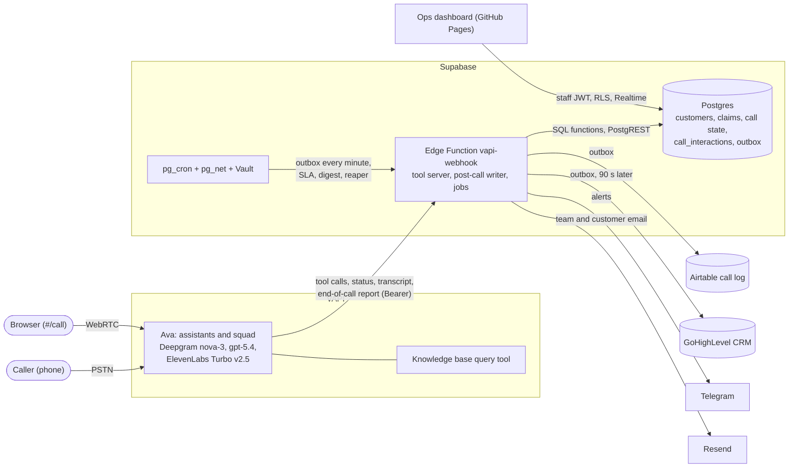

# Ava: voice agent for Observe Insurance claims

Ava answers the claims line of Observe Insurance, a fictional insurer. General questions (office
hours, mailing address, how claims work) get an answer straight away. For account questions she
verifies the caller by the phone number on the account and the date of birth, then summarizes their
claims, the documents still due and how to send them. She also takes a new claim by voice (first
notice of loss), records a new caller's details, requests a callback from a representative, and
handles emergencies and questions she cannot answer. Every call ends as a Postgres record (caller
name, summary, sentiment, timestamps, call reason) mirrored to an Airtable call log and a
GoHighLevel CRM contact.

Built on VAPI (Deepgram, OpenAI `gpt-5.4`, ElevenLabs) with a Supabase Edge Function as the tool
server, Postgres as the system of record and a React ops dashboard.

## Try it

| Channel | Where |
|---|---|
| Phone | +1 520 521 0277 |
| Web call, no sign-in | https://mannpandya1702.github.io/Claim-Agent/#/call (modes: Web assistant, Core, Squad) |
| Ops dashboard, staff sign-in | https://mannpandya1702.github.io/Claim-Agent/ |

The seeded customers are fictional and use reserved 555-01xx numbers.

| Name | Phone on account | Date of birth | Shows |
|---|---|---|---|
| Tobias Halvorsen | 602 555 0101 | March 14, 1986 | Two claims (one waiting on documents, one paid), wrong-DOB lockout, emailed checklist, filing a claim by voice |
| Ronan Quintero | 602 555 0102 | November 2, 1979 | Asking for a representative |
| Sloane Marchetti | 602 555 0103 | July 21, 1992 | A denied claim, then "how do I appeal?" from the knowledge base |
| Teague Ashdown | 602 555 0104 | January 30, 1965 | An early-stage claim; no email on file |
| Ines Lindqvist | 602 555 0105 | May 9, 1990 | A verified customer with no claims |
| (no account) | 602 555 0199 | - | Customer not found, then new-caller details and a claim taken for the claims team |

Things to say: "I'm calling to check on my claim", "What are your office hours?", "I'd like to talk
to a person", "I need to file a claim", "There's a fire in my kitchen right now", "Am I talking to
a real person?". Full scripts with the expected lines are in [docs/scenarios.md](docs/scenarios.md).

## Architecture



A call runs like this:

1. VAPI runs the audio loop: speech-to-text, the model, the voice, endpointing and barge-in.
2. When the model calls one of the ten server tools, VAPI posts to `vapi-webhook`. The function
   checks the Bearer (constant-time) and the org id, runs the tool against Postgres and returns a
   result code with a sentence the server wrote. VAPI speaks a sentence of up to 12 words itself; a
   longer one is marked `spoken: false` and the model reads it word for word, so the caller can
   interrupt it.
3. Escalations, emergencies and filed claims alert the team on Telegram and by email during the
   call. After hang-up, VAPI's end-of-call report is written to `call_interactions` and queued in
   an outbox for Airtable and GoHighLevel.
4. The dashboard reads Postgres with a staff JWT under row-level security and follows live calls
   over Realtime.

| VAPI object | Role |
|---|---|
| Observe Claims Web | Primary assistant: the ten server tools plus the knowledge base; bound to the phone number |
| Observe Claims Core | The ten server tools with no knowledge base; a fallback |
| Squad `observe-claims-web` | Concierge (account, contact and claim tools) hands general questions to Knowledge and back |
| Observe Claims Phone | Adds `transferCall`; rendered but not synced until a transfer number is set |

## Requirements coverage

Bare file names are in `supabase/functions/vapi-webhook/`; `partials/` is `vapi/prompts/partials/`.

| Capability | Implementation | Where to see it |
|---|---|---|
| Greeting and authentication | Ava speaks first and asks what the caller needs. The phone number is asked only for account questions; `lookup_customer` and `verify_identity` run a SQL state machine. Two wrong dates of birth lock the call | `partials/identity.md`, `supabase/migrations/0001_init.sql` |
| Claim status and documents | `get_claim_status` takes no customer argument; the customer comes from the verified session. A summary of at most 60 words, then on request the documents due, the due date and how to send them, or one claim's details | `speak.ts`, `vapi/tools/get_claim_status.json` |
| FAQ | FAQ facts rendered from `data/faq.json` into every prompt; long-tail questions through the knowledge base | `data/faq.json`, `scripts/render.ts` |
| Escalation | `escalate` at once, never asks why. The escalation row is written first, then Telegram and the team email; the spoken sentence depends on what was actually delivered, and asks a caller the team has no name for, once, who to ask for | `tools.ts`, `partials/representative-web.md` |
| Safety | Emergencies: the 911/988 line is a blocking tool message spoken before anything else, then a row, Telegram and email alerts, and an urgent CRM task after the call. Unsupported questions get a fixed line and one callback offer. Ava never claims to be human | `vapi/tools/report_emergency.json`, `partials/rules.md` (rules 9, 10, 22) |
| Post-call record | `caller_name`, `summary`, `sentiment`, `started_at`, `ended_at`, outcome, call reason, caller type, claim number, flags, cost and a redacted transcript; mirrored to a 21-field Airtable table and a GoHighLevel contact | `post_call.ts`, `airtable.ts`, `ghl.ts` |
| Tone | Contractions, one question per turn, turns of 60 words or fewer, one warm phrasing per server sentence, an upset-caller branch, a line check when the caller cannot hear | `partials/style.md`, `partials/branches.md`, rules 23 to 26 |
| Core flows | Happy path, authentication failure, customer not found (up to three different numbers per call), representative escalation | [docs/scenarios.md](docs/scenarios.md) |
| New callers and claims by voice | Name, spelled email and callback number read back and confirmed; a claim read back and filed only after a yes, with a `CLM-` number for a verified customer | `partials/contact.md`, `partials/claim-intake.md`, `loss_date.ts` |
| Multi-agent | Squad: Concierge owns the account tools; Knowledge has the knowledge base and no account access | `vapi/squad.json`, `vapi/assistants/` |
| Knowledge base | VAPI query tool `faq_search` (Gemini 2.5 Flash) over a file rendered from `data/faq.json` | `vapi/tools/faq_search.json`, `vapi/kb/` |
| Extra integrations | GoHighLevel CRM, Telegram, Resend, pg_cron jobs (SLA re-alert, daily digest, stale-call reaper, outbox), ops dashboard, staff-only recording links | `ghl.ts`, `jobs.ts`, `0004_automation.sql`, `dashboard/` |
| Limits | Live transfer is off: it needs a destination number (`REP_PHONE_E164`), so a representative request becomes a callback. Phone audio can stall; traced to the voice platform's media path | [Limitations](#limitations-and-next-steps) |

## Design highlights

### The server owns the truth; the model carries the words

Identity state, attempt counts, what may be disclosed, every outcome sentence, the loss date, the
claim number and the post-call outcome live in Postgres and Edge Function code keyed on the VAPI
call id. The model decides when to call a tool; the server decides what is true and what is said.

### Identity is a state machine in SQL

`lookup_customer_attempt` and `verify_dob_attempt` lock the call's session row, record each
`toolCallId` in a ledger and derive the result from ledger counts. Two wrong dates of birth lock the
call, and the lock is sticky. Unreadable input and system errors are never counted against the
caller, and a database outage never returns `not_found`. Identity fields in tool arguments, such as
`customer_id` or `identity_verified`, are stripped before the tool runs, so a prompt injection has
nothing to claim.

### Idempotent tool calls

A retried or duplicated delivery returns the stored result instead of running again. The DB suite
fires 8 concurrent deliveries of one `toolCallId` and checks that one attempt is recorded, and 8
concurrent filings of one claim intake to check that one claim is filed. Only the delivery that
filed it sends the confirmation and alerts the team.

### Nothing is confirmed without a read-back and a yes

`capture_contact` and `start_claim` store what the model heard as unconfirmed and read it back in a
server sentence (the email spelled out, the loss date as a weekday and date). Only `confirm_contact`
or `confirm_claim` with the caller's yes confirms it; a claim is filed in one transaction under a
row lock.

### An outbox with retries

The record is written from VAPI's end-of-call report, which also arrives after silence or a dropped
call. An hourly reaper rebuilds any call still without one after 2 h from VAPI's call record, or
closes it as abandoned. Each completed call queues one Airtable row and, when GoHighLevel is
configured, one GoHighLevel row due 90 s later. Each row gets up to 5 attempts under a 30 s lease,
and each destination has its own loop, so a failing one never blocks the other or loses the
Postgres record.

### Masking

Phone numbers, dates of birth and emails are masked by shape in every stored text, including spoken
digit words and spelled addresses. An answer to a sensitive question is stored as
`[answer withheld]`, and masking stays on through re-asks and line checks. Telegram cards carry ids
and enums only; Airtable gets the last four digits of the phone.

### No workflow engine

VAPI already runs the turn, the tool calls and the squad handoffs, and every outcome is
deterministic server code. A workflow engine or agent framework would add a hop to the
latency-critical path and no capability, so the backend is one Edge Function plus a Postgres outbox
driven by pg_cron.

### Turn-taking and latency, tuned from measurements

I broke down a 175 s phone call turn by turn from VAPI's event log, the stereo recording and the
packet capture ([docs/latency-investigation.md](docs/latency-investigation.md)).

| Measured before tuning | Value |
|---|---|
| Plain reply, caller stops to Ava's first word | 2.66 to 3.82 s, median 2.90 s |
| Typical split: final transcript / endpointing / model first token / chunking / TTS first audio | 0.57 / 0.61 / 0.87 / 0.18 / 0.84 s |
| Tool turn to the answer | 5.76 to 6.82 s (mean 6.25 s); VAPI held the tool result until the filler finished in 12 of 13 tool calls |
| Platform endpointing cap on a trailing sentence | about 2.86 s |
| TTS first audio, Multilingual v2 vs Turbo v2.5 (separate calls) | 836 ms vs 302 ms median |

What changed:

- Voice back to ElevenLabs Turbo v2.5 (speed 0.9), and shorter fillers.
- A LiveKit wait curve `200 + 300 * sqrt(x) + 1500 * x^3`: 200 ms to 2.0 s instead of the 2.86 s cap.
- Six custom endpointing rules: longer waits while a phone number or date of birth is incomplete
  (1.6 s), during spelling (2.5 s) and after Ava asks what happened (1.2 s); 0.5 s after a hearing
  complaint or a whole number said with "double" or "triple".
- Prompt rules for a caller who cannot hear Ava (25) and for saying something again (26).

Barge-in is set to 0.4 s of voice, with 26 interruption words and 22 acknowledgements that never
stop her. On a follow-up call with only the voice and filler changes live, VAPI's average turn
latency was 2.66 s against 3.30 s (part of the gap is the different conversation). Projected for
the full set, not yet measured: plain replies about 2.2 s and tool turns about 4.8 s.

## Tech stack

| Layer | Choice |
|---|---|
| Voice platform | VAPI: phone number, web calls, assistants, squad, knowledge base, hooks |
| Speech-to-text | Deepgram `nova-3`, 300 ms endpointing, 9 keyterms |
| Model | OpenAI `gpt-5.4`, temperature 0.3, max 400 tokens; Gemini 2.5 Flash for knowledge-base answers |
| Voice | ElevenLabs `eleven_turbo_v2_5`, speed 0.9, stability 0.75 |
| Backend | Supabase Edge Functions (Deno, TypeScript) |
| Data | Supabase Postgres 17, pg_cron, pg_net, Vault, Auth, RLS, Realtime |
| Integrations | Airtable, GoHighLevel, Telegram Bot API, Resend |
| Dashboard | React 18, Vite 7, Tailwind CSS 4, VAPI Web SDK, GitHub Pages |
| Quality | Deno test, Vitest, Playwright with axe, GitHub Actions |

## Repository layout

```
supabase/functions/vapi-webhook/   tool server, post-call writer, outbox (Airtable, GoHighLevel),
                                   scheduled jobs, redaction; unit tests beside each module
supabase/functions/recording-url/  staff-only presigned recording link
supabase/migrations/               0001-0010: schema, seed, dashboard RPCs, pg_cron jobs, outbox,
                                   caller contacts, claim intakes, GoHighLevel, lookup retries
vapi/prompts/partials/             prompt sections, assembled per assistant
vapi/assistants/                   shared settings (_shared.json) and per-variant overrides
vapi/tools/                        tool definitions: 10 server tools, the knowledge-base query tool,
                                   native and handoff tools
vapi/squad.json, vapi/kb/          squad definition and rendered knowledge-base file
data/faq.json                      single source for FAQ facts and the knowledge base
scripts/                           render, VAPI sync, DB runner, smoke, battery, voice harness,
                                   reset, jobs, Airtable and GoHighLevel tools
dashboard/                         React ops dashboard and public call page
fixtures/                          end-of-call report fixtures and redaction vectors
docs/                              design, operations and investigation docs
```

## Setup

### Prerequisites and configuration

Deno 2.x, the Supabase CLI (deploys), Node 22 (dashboard), and Python 3 with gTTS and ffmpeg for
the voice harness only. Copy [.env.example](.env.example) to `.env` (gitignored). Scripts read it
through `scripts/lib/env.ts` and fail naming any missing key.

| Group | Names |
|---|---|
| VAPI | `VAPI_PRIVATE_KEY`, `VAPI_PUBLIC_KEY`, `VAPI_ORG_ID`, `VAPI_WEBHOOK_SECRET` |
| Supabase | `SUPABASE_ACCESS_TOKEN`, `SUPABASE_PROJECT_REF`, `SUPABASE_URL`, `SUPABASE_ANON_KEY`, `SUPABASE_SERVICE_ROLE_KEY`, `SUPABASE_DB_PASSWORD` |
| Email and alerts | `RESEND_API_KEY`, `RESEND_FROM_EMAIL`, `CLAIMS_TEAM_EMAIL`, `OWNER_EMAIL` (seeded customers' address), `TELEGRAM_BOT_TOKEN`, `TELEGRAM_CHAT_ID` |
| Jobs and dashboard | `JOBS_BEARER` (same value as the Vault secret `jobs_bearer`), `STAFF_EMAIL`, `STAFF_PASSWORD` |
| Phone transfer | `REP_PHONE_E164` |
| GoHighLevel | `GHL_TOKEN`, `GHL_LOCATION_ID` (both required, or GoHighLevel is off), `GHL_ASSIGNEE_USER_ID`, `GHL_EMERGENCY_USER_ID` |
| Airtable (optional) | `AIRTABLE_TOKEN`, `AIRTABLE_BASE_ID`, `AIRTABLE_TABLE` (default "Call Log") |

The Edge Function reads its own secrets, including feature flags, through `env.ts`; the full list by
location is in [docs/architecture.md](docs/architecture.md#11-deployment-and-configuration).

### Prompts and VAPI config as code

Each assistant file in `vapi/assistants/` lists the prompt partials and tools it uses and is
deep-merged over `_shared.json`. `deno task render` builds every prompt, the knowledge-base file,
and the tool, assistant and squad payloads. `deno task sync:apply` pushes them with full-object
PATCHes and re-reads until VAPI agrees; `deno task sync:check` reports drift and exits 1 on any.

| Task | Purpose |
|---|---|
| `deno task check` / `test` / `lint` | Type-check, unit and conformance tests, lint (offline) |
| `deno task db push` | Apply `supabase/migrations/*.sql` over the Supabase Management API |
| `deno task render` | Render prompts, knowledge base and VAPI payloads |
| `deno task sync:check` / `sync:apply` | Compare with or update the live VAPI org |
| `deno task deploy` | Deploy `vapi-webhook` (VAPI Bearer, no JWT) and `recording-url` (staff JWT) |
| `deno task airtable:setup` | Create or complete the Airtable "Call Log" table; never deletes a field |
| `deno task staff` | Create the dashboard staff user and its allowlist row |
| `deno task reset -- --yes` | Clear per-call tables and phone-filed claims; keeps seeded customers and claims |
| `deno task jobs <sla\|digest\|reaper\|outbox>` | Run one scheduled job now |
| `deno task clean-room` | Fail if a tracked file contains a string from the local sensitive-strings list |

### Deploying

For a change: `db push`, `airtable:setup`, `deploy`, `sync:apply`, `smoke`. The server knows every
tool, and the Airtable fields exist, before any assistant can call or write them.

From an empty project: `db push`, `probe credential` (creates the VAPI Bearer credential), Edge
Function secrets, `deploy`, the Vault secret `jobs_bearer`, `airtable:setup`, `render`,
`sync:apply`, disable Auth sign-ups, `staff`, `reset -- --yes`, `smoke`, `sync:check`. The function
URL in `invoke_job` (`0004_automation.sql`) is project-specific, and the cron jobs fail until
`jobs_bearer` exists.

Dashboard: `cd dashboard && npm ci`, then `npm run dev`, `npm test`, `npm run build`, or
`npm run smoke` (Playwright with axe). `.github/workflows/dashboard.yml` tests, builds and publishes
it to GitHub Pages on every push to `main` that touches `dashboard/`.

## Testing

| Suite | Command | Size | What it covers |
|---|---|---|---|
| Unit and conformance | `deno task test` | 925 tests in 33 files, 49 of them conformance | Every tool code and sentence, identity rules, claim gate, loss-date parsing, call-reason precedence, redaction, outbox, GoHighLevel against an in-memory twin; rendered prompts, tools and voice settings pinned |
| Recording link | `deno test --allow-env supabase/functions/recording-url/` | 13 tests | Staff-only link logic |
| Dashboard | `npm test` | 349 tests in 35 files | Pages, data mapping, empty and error states |
| Persona battery | `deno task battery` | 47 personas x 3 runs = 141 conversations | The rendered Core prompt on VAPI `/chat` with mocked tools that return the real server sentences: tool order, arguments, no disclosure before verification, emergency scoping, injection, line trouble. `--dry-run` builds every request offline |
| Smoke | `deno task smoke` | 25 cases | The deployed webhook with real auth: identity ladder, smuggled arguments, contact capture, status details, claim filing, post-call writers; deletes the call rows it wrote |
| Database | `deno task db:test` | 32 cases | Rolled-back SQL assertions plus concurrent deliveries, lockout, claim filing races, outbox lease, grants and RLS |
| Voice | `deno task voice <scenario>` | 11 scenarios | Real VAPI calls with a synthetic caller (Google TTS) over WebSocket, both sides recorded; includes two barge-in measurements |

CI (`.github/workflows/ci.yml`) runs `check`, `test`, `lint`, the recording-link tests and the
clean-room guard on every push and pull request. The battery runs there on manual dispatch because
it spends VAPI credit; the other live suites run on demand. Last full live runs: smoke 23 of 23 and
the DB suite 28 of 28, before the newest cases of each were added (two for smoke, three for the DB
suite). The latest live battery, on the 14 line-trouble and related personas, passed 13 of 14; the one
failure was wording only.

## Documentation

| Doc | Contents |
|---|---|
| [docs/architecture.md](docs/architecture.md) | Components, webhook message types, data model and migrations, deployment, secrets by location |
| [docs/agent.md](docs/agent.md) | Assistant settings, variants and squad, prompt structure, tools and their sentences |
| [docs/integrations.md](docs/integrations.md) | Customer lookup, post-call write-back, Airtable and GoHighLevel mapping, authentication per hop |
| [docs/decisions.md](docs/decisions.md) | Design decisions, trade-offs and production upgrades |
| [docs/reliability.md](docs/reliability.md) | Failure handling, what the caller hears, test strategy |
| [docs/runbook.md](docs/runbook.md) | Operating the system: checks, resets, logs, fallbacks |
| [docs/latency-investigation.md](docs/latency-investigation.md) | Turn-by-turn latency and audio analysis of a phone call, and what changed |
| [docs/scenarios.md](docs/scenarios.md) | Call scenarios with caller lines, expected answers and resulting records |
| [docs/changelog.md](docs/changelog.md) | Build history |

## Limitations and next steps

### Open items

- Live transfer is off. With no `REP_PHONE_E164`, the phone gives a callback, and the Observe
  Claims Phone variant with `transferCall` is not synced.
- Phone audio can break up. On the measured call, 7 holes of 154 to 346 ms in Ava's audio came from
  stalls inside VAPI's media path, while the carrier leg lost 1 packet of 8,508. The same pattern
  appeared with three voice models, and no setting removes it.
- Barge-in is configured for voice activity, but on the measured calls VAPI stopped Ava only once
  a partial transcript arrived, 0.66 to 1.23 s after the caller began.
- The endpointing changes and rules 25 and 26 are not yet measured on a live call, and the full
  battery has not been run live on the final prompt.

### Deliberate shortcuts

| Shortcut | Production upgrade |
|---|---|
| Account existence is revealed at the phone step, bounded by three numbers per call | Uniform reply plus an SMS one-time code |
| Lockout counters are per call | Per-customer failure window plus step-up OTP |
| Date of birth stored plain (fictional data) | HMAC with a server pepper |
| Recordings carry spoken PII | Private storage plus audio redaction |
| Resend sandbox sender, which delivers only to the Resend account's own address | A verified sending domain |
| Claim-task due dates skip weekends but not holidays | A holiday calendar |

### Next steps

- A phone call to measure the tuning (endpointing, first audio, tool turns) and check whether
  `waitSeconds` 0.4 acts as a floor under the new curve.
- Report the media-path stalls to VAPI with the call evidence.
- A scripted phone run of the core flows, and a transfer number to switch on live transfer.
- Not built yet: GoHighLevel custom fields, opportunities and SMS; a call-quality score bounded by
  server facts; voicemail and after-hours flows; an adapter for a real claims system.
