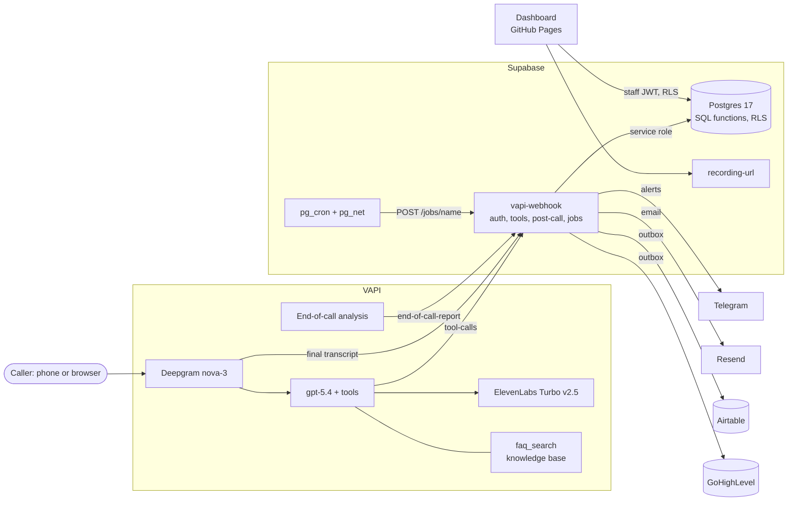
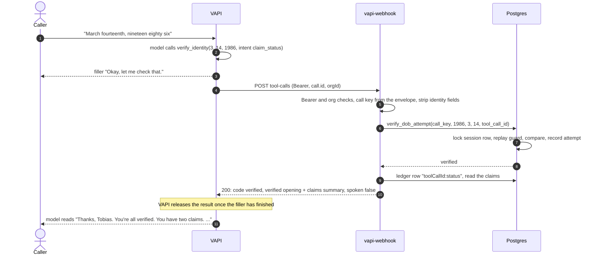
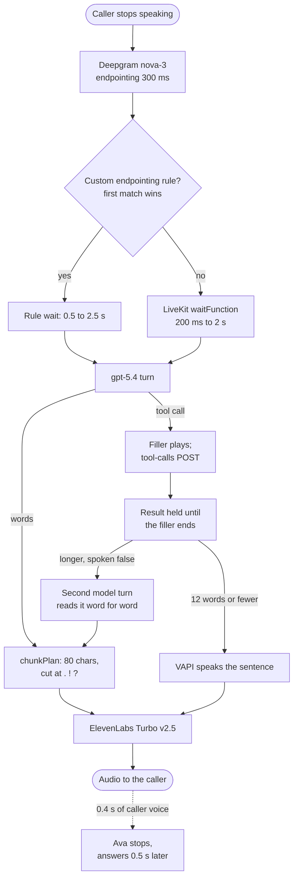
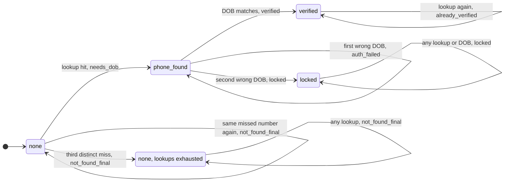
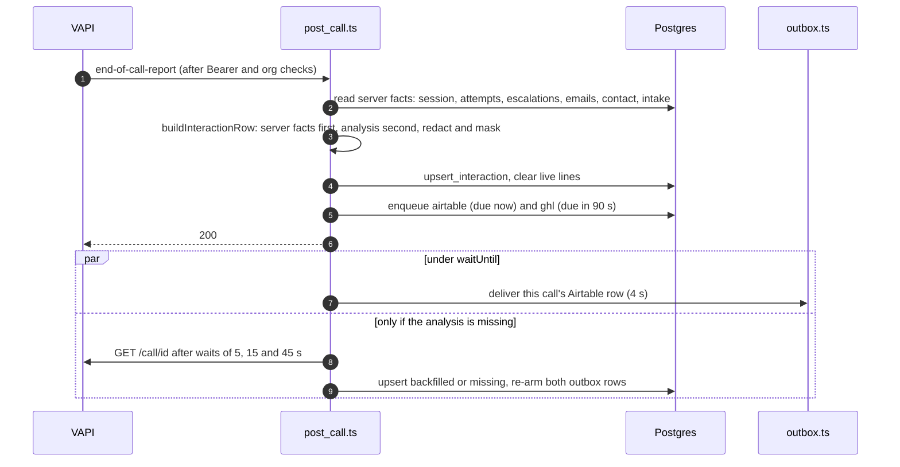

# Architecture

Ava answers the Observe Insurance claims line on VAPI. A Supabase Edge Function is the tool server
and post-call writer, Postgres holds customers, claims and all per-call state, and an outbox mirrors
every call to Airtable and GoHighLevel.

Related: assistant settings, prompts and spoken sentences in [agent.md](agent.md); vendor mappings
in [integrations.md](integrations.md); failure behaviour and tests in
[reliability.md](reliability.md); trade-offs in [decisions.md](decisions.md); operations in
[runbook.md](runbook.md).

## Contents

1. [Design principle](#1-design-principle)
2. [Components](#2-components)
3. [Data flow for a call](#3-data-flow-for-a-call)
4. [Webhook request handling](#4-webhook-request-handling)
5. [Tool call path](#5-tool-call-path)
6. [Turn-taking pipeline](#6-turn-taking-pipeline)
7. [State management](#7-state-management)
8. [Post-call pipeline and outbox](#8-post-call-pipeline-and-outbox)
9. [Data model](#9-data-model)
10. [Security](#10-security)
11. [Deployment and configuration](#11-deployment-and-configuration)
12. [Scalability and production considerations](#12-scalability-and-production-considerations)

---

## 1. Design principle

The model holds the conversation and decides when to call a tool. Anything that must be correct is
decided by the server, keyed on the VAPI envelope rather than on model arguments.

| Concern | Decided by |
|---|---|
| Who the caller is, how many attempts are left | `call_sessions` and `attempts` rows, written by SQL functions under a row lock |
| Which customer's claims are read | The verified session; `get_claim_status` takes no account argument |
| What is said for each outcome | One `speak.ts` sentence per result code |
| Whether contact details or a claim are confirmed | A second tool call on the caller's yes to a server read-back |
| Claim filing and the claim number | `file_claim_intake_once` under a row lock; the `CLM-` number is drawn in SQL |
| The date of loss | `loss_date.ts`, from the caller's own words against today in New York |
| Whether the team or the customer was notified | The transport's confirmation (Telegram `ok`, a Resend message id) |
| Post-call outcome and call reason | Server facts first, VAPI's analysis second |
| What may be stored | Redaction and masking before every write |

Every branch has a next step, and every failure has a sentence written for it.

---

## 2. Components

| Component | Technology | Responsibility |
|---|---|---|
| Voice platform | VAPI with Deepgram `nova-3`, OpenAI `gpt-5.4`, ElevenLabs `eleven_turbo_v2_5` | Phone and web calls, tool calling, squad handoffs, knowledge-base query tool, end-of-call analysis |
| Assistants | Five variants rendered from one shared block; four synced | Ava on the web, on the phone line and in a two-member squad ([agent.md](agent.md)) |
| Tool server and post-call writer | Edge Function `vapi-webhook` (Deno, TypeScript) | Authenticates and routes every VAPI message, runs the ten server tools, writes the call record, delivers the outbox, runs scheduled jobs |
| System of record | Supabase Postgres 17 | Customers, claims, per-call state, caller contacts, claim intakes, call records, escalations, email ledger, outbox |
| Scheduler | pg_cron, pg_net, Vault | Calls `/jobs/{sla,digest,reaper,outbox}` on the webhook |
| Call log | Airtable ("Call Log" table) | External call log, written through the outbox |
| CRM | GoHighLevel (one sub-account, API version `2021-07-28`) | One contact per trusted number, `oi-` tags, a redacted note and up to three tasks per call |
| Alerts and email | Telegram Bot API, Resend | Team alerts, SLA re-alerts, daily digest, customer info emails and claim confirmations |
| Recording links | Edge Function `recording-url` | Staff-only presigned recording URL, so the VAPI private key never reaches the browser |
| Ops dashboard | React 18, Vite, Tailwind and shadcn, TanStack Query, supabase-js, `@vapi-ai/web`; GitHub Pages | Staff views over RLS (overview, calls, live, escalations, ops) and the public `#/call` page |
| Config tooling | `scripts/render.ts`, `scripts/vapi_sync.ts` | Prompts, tools, assistants and squad as code, with drift detection |

---

## 3. Data flow for a call

1. The greeting asks how Ava can help. General questions are answered from the FAQ facts in the
   prompt or the knowledge-base tool, with no verification and no server tool.
2. For anything about the caller's own claim or account, the model calls a server tool. VAPI plays
   the tool's short filler and POSTs `tool-calls` to the webhook.
3. The webhook resolves the call from the envelope, runs the tool against Postgres (and Telegram or
   Resend when someone must be told) and answers with a result code and a sentence.
4. Final transcript lines are redacted and stored in `transcript_lines` for the live view.
5. When the call ends, VAPI posts `end-of-call-report`. The webhook builds the call record from
   server facts plus VAPI's analysis, upserts it into `call_interactions` and queues it for Airtable
   (tried at once) and GoHighLevel (due 90 s later).
6. pg_cron runs the outbox every minute, and an hourly job closes calls whose report never arrived.

One tool call, a date-of-birth check that also reads the claims:

---

## 4. Webhook request handling

`index.ts` builds the dependencies once per isolate (store, fetch, environment, clock, `waitUntil`,
logger). `handler.ts` then handles each request in order:

1. `GET /health` answers `{ok: true}` without auth. Any other non-POST is 405.
2. `POST .../jobs/<name>` needs a Bearer equal to `JOBS_BEARER` and a known job name, otherwise 404.
3. Every other POST: constant-time Bearer compare against `VAPI_WEBHOOK_SECRET`, otherwise 401.
4. The JSON body must hold a `message` object, otherwise 400.
5. `message.call.orgId` (or `message.chat.orgId`) must equal `VAPI_ORG_ID`, otherwise 403.
6. With `CAPTURE_WEBHOOKS=true`, the body is stored in `webhook_captures` with tool arguments
   stripped and strings redacted.
7. Route by `message.type`, then write one JSON log line: call key, type, status, tools, codes,
   error, milliseconds. Never a phone number, date of birth, email or argument.

The call key comes only from the envelope: `call.id`, else `chat.sessionId`, else `chat.id`. The
channel comes from `call.type`, and the caller ID from `call.customer.number`, ignoring placeholders
and the numbers in `OWN_NUMBERS`.

| `message.type` | Handler | Effect | HTTP answer |
|---|---|---|---|
| `tool-calls` | `toolCalls` → `tools.ts` | Runs each call in order, answers `{name, toolCallId, result, message}` per call | 200; 400 only if the envelope has no call key |
| `status-update`, `in-progress` | `onStatusUpdate` | Session and a stub call record (`outcome: in_progress`) for the live view | 200; 500 on a DB failure |
| `status-update`, `forwarding` | `onForwarding` | Phone transfer: escalation row, then Telegram and team email; never alerts twice | 200; 500 if the row fails |
| `transcript` (final only) | `onTranscript` | One redacted line in `transcript_lines`; a caller answer to a DOB or phone question is stored as `[answer withheld]` | 200; 500 if the line fails |
| `end-of-call-report` | `onEndOfCallReport` | Builds and upserts the call record, queues the outbox, starts the analysis backfill if needed | 200; 500 on a store failure |
| anything else | none | Authenticated, then ignored | 200 |

A tool call with a call key always gets a 200. An error status makes VAPI fall back to a generic
failure line or leaves the model to improvise, so a server fault is answered with a written sentence
instead (`system_error`, or a safer tool-specific fallback). Post-call messages are the opposite: a
5xx is wanted, because VAPI redelivers (3 retries, exponential) and every post-call write is
idempotent.

VAPI-native tools (`endCall`, `transferCall`, `faq_search` and the two handoffs) never reach the
webhook. Their use is visible afterwards in the report's message history.

---

## 5. Tool call path

- `parse_tool_request.ts` accepts every envelope shape (`toolCallList`, `toolCalls`,
  `toolWithToolCallList`) and arguments as an object, a JSON string or double-encoded JSON.
- It is also the trust boundary. It drops `identity_verified`, `verified`, `customer_id`,
  `call_key`, `caller_phone` and `level` from every tool (matched case- and separator-insensitively),
  and `phone` from every tool except `lookup_customer`. Values containing `{{` or equal to
  `unknown`, `null` or `undefined` are refused as `bad_args`; `report_emergency` drops bad arguments
  instead of refusing.
- Calls in one delivery run in the model's order, because a batch such as `lookup_customer` then
  `verify_identity` must walk the identity ladder in order.
- The sentence is always inside `result`, so the model's history matches what the caller heard. A
  sentence of up to 12 spoken words is also sent as a native `request-complete` message, which VAPI
  speaks verbatim. A longer one (or one over 1,000 characters) carries `spoken: false`, and the
  model reads it word for word. [agent.md](agent.md#5-tools) explains the trade-off.

| Budget | Value | Where | Purpose |
|---|---|---|---|
| VAPI tool timeout | 10 s | tool JSON `server.timeoutSeconds` | Platform limit |
| Batch | 8.5 s | `BATCH_BUDGET_MS` | Later calls get what is left; an emergency is still logged |
| Tool | 5 s | `TOOL_BUDGET_MS` | The tool answers its own fallback sentence |
| Handler backstop | 6 s | `TOOL_BACKSTOP_MS` | Only for a tool that throws or hangs past its own budget |
| Notification channel | 2.5 s each, in parallel | `CHANNEL_BUDGET_MS` | Telegram, team email and claim confirmation fit inside the tool budget |
| Answer margin | 250 ms | `ANSWER_MARGIN_MS` | The answer leaves first; write-backs continue under `waitUntil` |
| Store call | 5 s | `store.ts` | A hung query becomes `system_error`, never a business answer |
| Slow-tool filler | 3 s | `request-response-delayed` | "Thanks for bearing with me, almost there." |

A counted SQL step (an identity attempt, a claim filing) is one transaction that commits whole or
not at all; a retry of the same `toolCallId` replays the stored code. For uncounted tools the ledger
records the code VAPI actually received, so a retry replays what the caller heard. A counted step
that commits after the 5 s budget records its SQL result while the caller heard the fallback, a
known gap listed in [reliability.md](reliability.md#7-known-issues).

---

## 6. Turn-taking pipeline

VAPI runs every stage of a turn; the repo sets their parameters ([agent.md](agent.md#14-turn-taking)).
The stages run one after another, so their times add up.

Measured on a phone test call on 2026-10-13, before the latest endpointing and voice changes:

| Stage | Setting | Measured |
|---|---|---|
| Final transcript | Deepgram `nova-3`, `endpointing: 300` | 0.51 to 0.76 s after the caller stopped |
| End of turn | Six custom rules, else LiveKit smart endpointing | 0.42 to 0.59 s on plain turns; up to 2.875 s on VAPI's built-in curve, now replaced by a `waitFunction` capped at 2 s |
| Model | `gpt-5.4`, `maxTokens: 400` | First token 0.65 to 1.09 s (median 0.89 s) |
| Chunking | At least 80 characters, cut at `.` `!` `?` | About 0.18 s |
| Voice | ElevenLabs Turbo v2.5 | First audio median 0.84 s on Multilingual v2 on that call; about 0.30 s on Turbo v2.5 on an earlier call |
| Barge-in | `numWords: 0`, `voiceSeconds: 0.4`, `backoffSeconds: 0.5` | VAPI stopped Ava when a partial transcript arrived, 0.66 to 1.23 s after the caller began |

The 200 ms to 2 s range of the new `waitFunction` is computed from its formula and has not yet been
measured on a live call.

On a tool turn, VAPI posts `tool-calls` while the filler plays but releases the result only after
the filler has finished playing, even with `blocking: false`. On the test call the result was
released 1 to 2 ms after the filler stopped, although the webhook had answered 212 to 1,784 ms
earlier. A `spoken: false` sentence then needs a second model turn: the gap from the end of the
filler to the answer was 2.20 to 2.52 s. Fillers are kept short for this reason.

A complaint about hearing Ava ("your voice was breaking", "can you hear me?") matches the last
endpointing rule and is answered after 0.5 s; prompt rule 25 turns it into one short turn with no
tool. Audio stalls inside VAPI's media path on phone calls are outside what assistant settings can
change. The turn-by-turn analysis is in [latency-investigation.md](latency-investigation.md).

---

## 7. State management

### 7.1 Where state lives

The Edge Function holds no conversation state. Per-call state lives in Postgres, keyed on the call
key from the envelope:

| Table | Key | Holds |
|---|---|---|
| `call_sessions` | `call_key` | Identity `level` (`none`, `phone_found`, `verified`, `locked`), candidate and verified customer ids, channel, caller ID |
| `attempts` | `(call_key, tool_call_id)` | One row per tool call: tool, kind, returned code; never arguments. The attempt counter, replay guard and tool timeline in one |
| `lookup_numbers` | `(call_key, number_hash)` | SHA-256 of each number that missed; service role only |
| `caller_contacts` | `call_key` | A captured name, email and callback number with its source, confirmed or not |
| `claim_intakes` | `call_key` | The loss being reported, pending until filed |
| `escalations`, `emails` | `(call_key, kind)` | One representative and one emergency row; one email per kind |
| `call_interactions` | `vapi_call_id` | The post-call record |
| `transcript_lines` | `(call_key, role, ts_ms)` | Redacted live transcript, cleared at the end of the call |

Because state is keyed on the call, not the assistant, it survives a squad handoff. The model's
memory is only conversational: a model talked into believing a caller is verified, or a claim filed,
still meets a server that refuses.

The ledger also carries flow memory across turns: whether a `start_claim` was sent to verification
first (so the next sentence offers to resume), whether a loss date was unreadable before
(`claim_date_help`), and whether `contact_needs_phone` was already asked.

### 7.2 Identity state machine

Implemented by `lookup_customer_attempt` and `verify_dob_attempt` (`0001_init.sql`; lookups counted
by distinct number since `0010_lookup_retries.sql`), mirrored in pure TypeScript by `identity.ts`
for the in-memory store and unit tests.

- Replay guard: each counted call upserts the session row, takes `SELECT ... FOR UPDATE`, and
  returns the stored code if its `toolCallId` is already in `attempts`. Otherwise it derives the
  code from ledger counts and records the attempt. Eight concurrent deliveries of one `toolCallId`
  record exactly one attempt (live DB suite).
- Two wrong dates of birth lock the call; a correct one afterwards still gets `locked`. A missed
  number answers `not_found_final` if looked up again, a different number may still be tried, and
  three distinct misses end lookups for the call.
- Missed numbers are stored as SHA-256 in `lookup_numbers`, readable only by the service role.
  `attempts` is staff-readable and published to Realtime, and a hash of a ten-digit number can be
  brute-forced.
- Any ten digits are looked up; only a wrong length or one repeated digit is `invalid_phone`.
  Unreadable input and system errors never count toward a lock or a miss. Three unreadable dates
  give `dob_give_up`, which speaks the locked sentence without setting the lock.
- `auth_failed` never says which part mismatched, no name is spoken before `verified`, and
  `system_error` is distinct from `not_found`, so an outage never tells a customer "I can't find
  you".
- Counters are per call, so a redial starts fresh. The per-customer alternative is in
  [decisions.md](decisions.md).

### 7.3 Confirmations and the claim gate

Contact capture and claim intake follow one pattern: a tool validates what the model heard, stores it
unconfirmed and reads it back; only the caller's yes, through a second tool (`confirm_contact`,
`confirm_claim`), confirms it. Changing any contact detail, the number included, clears the
confirmation. A filed intake is never rewritten or un-filed.

`start_claim` reads only server state (`claimGate` in `tools.ts`):

| Server state | `start_claim` answers |
|---|---|
| Session `locked` | `claim_locked`: a callback offer, no claim on this call |
| Session `phone_found` | `claim_needs_verification`: asks for the date of birth |
| Session `verified` | Proceeds as kind `claim` on the session's customer |
| Confirmed new-caller contact | Proceeds as kind `lead_intake`; `claim_needs_phone` if there is no number to call back |
| No lookup yet | `claim_needs_lookup`: asks for the number on the account |
| Lookup missed, no confirmed contact | `claim_needs_contact`: asks for the caller's name |
| Intake already filed on the call | `claim_already_filed` |

### 7.4 Idempotency

| Effect | Key | Mechanism |
|---|---|---|
| Counted identity attempt | `(call_key, tool_call_id)` | Ledger insert under the session row lock |
| Other server tools | `(call_key, tool_call_id)` | `claimAttempt`; a retry replays the stored code, and read-backs are rebuilt from the stored row |
| Chained status read | `tool_call_id + ":status"` | A second ledger row, claimed once |
| Caller contact | `call_key` | `upsert_caller_contact`: an identical capture keeps the confirmation, any change clears it |
| Claim intake | `call_key` | `upsert_claim_intake` replaces only a pending intake; `file_claim_intake_once` returns `filed_now` only to the delivery that filed |
| Phone-filed claim | `claims.reported_call_key`, `claim_number` (both unique) | One claim per call; a taken number is redrawn (up to 20 draws) |
| Escalation | `(call_key, kind)` | `upsert_escalation` inserts once and merges only a new callback number and details |
| Email | `(call_key, kind)` + Resend `Idempotency-Key` | Ledger row claimed as `sending` before the send |
| Call record | `vapi_call_id` | `upsert_interaction`: per-column, forward-only merge |
| Live transcript line | `(call_key, role, ts_ms)` | `on conflict do nothing` |
| Outbox row | `(kind, ref_id, destination)` | Compare-and-set claim with a 30 s lease |
| GoHighLevel writes | `outbox_events.progress` | Each step saved before the next; a done step is never repeated |
| Scheduled job run | `(job, period_key)` | `job_runs` row claimed first |

A parallel duplicate that arrives before the first delivery stored its code runs again, but the
escalation, email and intake rows keep it from paging, sending or filing twice.

---

## 8. Post-call pipeline and outbox

### 8.1 End of call

A partial report that arrives after a complete record is ignored. GoHighLevel waits 90 s so the
backfill (about 5, 20 and 65 s after the report) has landed before tags and the note are written.

How the record is built (`buildInteractionRow`, a pure function):

| Field | Rule |
|---|---|
| `outcome` | Emergency row (`emergency`) > representative escalation or transfer (`escalated`) > filed claim intake (`resolved`) > locked session (`auth_failed`) > never verified with at least one miss and no match (`not_found`) > verified with a status read (`resolved`); then a silence or max-duration end (`abandoned`); then the analysis outcome; then `resolved` if the caller spoke, else `abandoned` |
| `call_reason` | Server facts (emergency row, filed intake) > structured output > derived from tool results; a weaker source never replaces a stronger one; null rather than invented |
| `caller_name` | Verified customer's name > confirmed captured name > the analysis' name; the last two never next to an unverified account match; else "Unknown caller" |
| `caller_type` | `existing` (the session reached an account), `new` (a new-caller contact was captured) or `unknown` |
| `sentiment` | VAPI analysis > structured output > backfill; else NULL with `analysis_status = missing` |
| `flags` | Five evidence-first flags, each needing what the agent said and a missing server fact: `promised_callback_without_escalation`, `status_read_without_verified_identity`, `tool_markup_spoken`, `email_promised_without_send`, `claim_promised_without_filing` |
| `transcript`, `summary`, `messages` | Masked and redacted; tool chips carry codes, never arguments |

`upsert_interaction` merges per column: empty text and null values never overwrite stored ones,
booleans OR, `caller_type` is never downgraded to `unknown`, `call_reason` is replaced only by an
equal or higher-ranked source, and a row that has ended is only updated by a row that also ends.

### 8.2 Outbox

The webhook path never waits on a third party, and a record is never lost because one was down.

- One `outbox_events` row per `(kind, ref_id, destination)`. A later improvement to the record
  (backfill, reaper) re-arms the row: attempts reset, due time moved, GoHighLevel `progress` kept.
- Delivery is at-least-once, capped at 5 attempts; each claim spends one before the request. The
  payload is read fresh at delivery, so a re-armed row sends the improved record. Airtable upserts
  on Call ID; GoHighLevel saves each step (contact id, tags, note id, task ids) to `progress`, so a
  retry redoes only what is missing.
- The Airtable fast path and the every-minute job claim rows by compare-and-set on `attempts` and
  `updated_at` with a 30 s lease, so one runner owns a row. A delivery that started before a re-arm
  cannot mark the newer version delivered.
- Each destination has its own loop that stops at its own first failure, so an Airtable outage
  never blocks GoHighLevel or the reverse. Without `GHL_TOKEN` and `GHL_LOCATION_ID`, no
  GoHighLevel row is queued.

| Response | Airtable | GoHighLevel |
|---|---|---|
| 2xx | Delivered | Step saved; delivered after the last step |
| 429 | Retried next run | Retried after the `x-ratelimit-interval-milliseconds` header (default 10 s) |
| 5xx or timeout | Retried next run | Retried after 60, 120, 240, then 480 s |
| 401, 403 (and 404 for Airtable) | Attempt refunded, loop paused, `config_error` in the run result | Same |
| Contact not found (GoHighLevel) | n/a | Stored contact id cleared and the contact resolved again once; then retried with backoff |
| Other 4xx | Dead | Dead |

Field mappings and the GoHighLevel contact rules are in [integrations.md](integrations.md).

### 8.3 Scheduled jobs

pg_cron calls `invoke_job(name)`, which reads the bearer from Vault (`jobs_bearer`) and POSTs
`/jobs/<name>` through pg_net. Each run claims `(job, period_key)` in `job_runs` first, works to an
8 s deadline and records counts only.

| Job | Schedule (UTC) | Period key | Work |
|---|---|---|---|
| `claims-sla` | `*/10 * * * *` | 10-minute slot | Escalations unclaimed after 30 min get one Telegram re-alert and an email |
| `claims-digest` | `0 12 * * *` | Eastern date | Last 24 hours' counts to the claims team; the Eastern key keeps DST from sending two or none |
| `claims-reaper` | `7 * * * *` | UTC hour | Calls with no report after 2 h are rebuilt from `GET /call/{id}` or closed as `abandoned` (VAPI 404, or after 24 h); ended calls missing an outbox row in the last 48 h are queued; live lines, captures and SLA and outbox job runs older than 7 days are pruned. Never notifies |
| `claims-outbox` | `* * * * *` | UTC minute | Airtable loop, then GoHighLevel loop |

---

## 9. Data model

Value lists are `text` plus `CHECK` constraints mirrored by `enums.ts`, with a parity test. RLS is
on for every table, `anon` holds no grants, and the service role is granted explicitly. An applied
migration is never edited; changes go in a new file.

| Migration | Adds |
|---|---|
| `0001_init.sql` | Tables, CHECKs, RLS, revoked default grants, identity functions, `upsert_escalation`, `upsert_interaction` |
| `0002_seed.sql` | Five fictional customers and five claims (602 555 01xx numbers) |
| `0003_dashboard.sql` | `staff` allowlist, `is_staff()` select policies, masked phone columns, dashboard RPCs, `ops_health` view, Realtime publication |
| `0004_automation.sql` | `invoke_job` and the four pg_cron jobs |
| `0005_outbox.sql` | `outbox_events`, `enqueue_outbox`, `claim_outbox`, outbox counts in `ops_health` |
| `0006_contacts.sql` | `caller_contacts` and its functions; `caller_type` and `caller_email` on the call record |
| `0007_fnol_reasons.sql` | `claim_intakes` and filing functions, `claims.reported_call_key`, call reason with source-ranked merge, `call_reason_counts` |
| `0008_ghl.sql` | Outbox destination `ghl`, `progress`, `next_attempt_at`, delayed enqueue, `save_outbox_progress` |
| `0009_review_fixes.sql` | A changed callback number needs a new confirmation; `file_claim_intake_once` returns `filed_now` |
| `0010_lookup_retries.sql` | `lookup_numbers`; lookups counted by distinct number |

Tables not covered in section 7.1:

| Table | Purpose |
|---|---|
| `customers` | Seeded policyholders; `phone_e164` unique; never granted to the browser |
| `claims` | Seeded claims plus phone-filed claims marked by `reported_call_key`; never granted to the browser |
| `outbox_events` | Delivery queue per destination, with `attempts`, `next_attempt_at`, `progress`, masked `last_error` |
| `job_runs` | One row per job and period |
| `staff` | Dashboard allowlist read by `is_staff()` |
| `webhook_captures` | Optional request captures, arguments stripped, kept 7 days |

---

## 10. Security

### 10.1 Authentication per hop

| Hop | Mechanism |
|---|---|
| VAPI → `vapi-webhook` | Bearer from a VAPI custom credential referenced by `credentialId` (the secret is in no config file), compared in constant time, then the org id check. Gateway JWT verification is off for this function |
| pg_cron → `/jobs/*` | Bearer read from Vault at call time; a wrong bearer or unknown job is a 404 |
| Webhook → Postgres | Service-role key injected by the platform; SQL functions executable by `service_role` only |
| Dashboard → Postgres | Supabase Auth (sign-ups off), `staff` allowlist, one `is_staff()` select policy per granted table. `customers` and `claims` are never granted; the only browser writes are the `call_interactions.staff_notes` column and two security-definer escalation functions |
| Dashboard → `recording-url` | Gateway verifies the JWT; the function checks `is_staff()` and that the caller can read the call under RLS, then returns a short-lived presigned link; CORS allowlist |
| Browser → VAPI | Public key in the web SDK |
| Webhook → Airtable, GoHighLevel, Telegram, Resend | Tokens held as Edge Function secrets; errors masked before they are stored; Resend calls carry an idempotency key per `(call, kind)` |

### 10.2 PII controls

- Transcripts, summaries, raw analysis, escalation details, claim descriptions and live lines are
  redacted by shape before storage: digit runs in any grouping, spoken digit words and
  birth-plausible dates.
- A caller turn answering a date-of-birth, phone, email or spelling question is masked whole,
  because speech recognition splits a spoken date into fragments no pattern can be trusted to catch.
  Masking carries through a re-ask, a line check or a hold line right after the question (the latest
  6 assistant lines on the live path), in all three views: live lines, the stored transcript and the
  message bubbles.
- Logs carry ids, enums and timings; the logger drops identity fields and arguments at any depth.
- Telegram cards are closed types (`EscalationAlert`, `ClaimIntakeAlert`) that can express only ids,
  enums and at most a claim number's last three digits.
- Customer emails are rendered only from database facts. Team emails add the caller's name,
  callback number and the redacted details (at most 500 characters), HTML-escaped and forced to
  ASCII.
- Email addresses are taken by voice in two cases only: a new caller's details, and a verified
  customer with none on file. The caller spells the address and the server reads it back; an
  address added for an existing account is never written to `customers` and never sent to.
- List views read generated masked phone and email columns; only the call detail page selects a
  full number. Airtable receives the phone's last four digits.
- Recordings still contain spoken PII; the production upgrade is in [decisions.md](decisions.md).

### 10.3 Sensitive-strings guard

`deno task clean-room` fails if any tracked text file contains a string from a local, gitignored
list (`.banned-strings.local`). The pre-push hook runs it; CI runs the step but skips it, because
the list never leaves the developer machine.

---

## 11. Deployment and configuration

| Piece | Deployed by | Notes |
|---|---|---|
| Schema and seed | `deno task db push` | Management API over HTTPS, one transaction per file |
| Edge Functions | `deno task deploy` | `supabase functions deploy --use-api`; per-function `deno.json` with `lock: false` because the remote bundler cannot read the local lockfile format |
| Vault secret | `vault.create_secret(..., 'jobs_bearer')`, by hand | Same value as `JOBS_BEARER`; never in a migration |
| Cron jobs | `0004_automation.sql` | `invoke_job` holds this project's function URL; another project must change it first |
| VAPI config | `deno task sync:apply`, verified by `sync:check` | `solo-phone` and `transferCall` are withheld until `REP_PHONE_E164` is set |
| Airtable table | `deno task airtable:setup` | Idempotent; never deletes or retypes a field |
| Dashboard | `.github/workflows/dashboard.yml` on pushes to `main` that touch `dashboard/` | Typecheck, Vitest, build, publish to GitHub Pages |

Update order for a change: `db push`, `airtable:setup`, `deploy`, `sync:apply`, `smoke`. Migrations
are additive, so the deployed function keeps working while a migration lands.

Secrets and configuration by location (names only; no values are in the repository):

| Location | Names |
|---|---|
| `vapi-webhook` secrets, required | `VAPI_ORG_ID`, `VAPI_WEBHOOK_SECRET` (without them the function fails closed) |
| `vapi-webhook` secrets, optional | `VAPI_PRIVATE_KEY`, `JOBS_BEARER`, `TELEGRAM_BOT_TOKEN`, `TELEGRAM_CHAT_ID`, `RESEND_API_KEY`, `RESEND_FROM_EMAIL`, `CLAIMS_TEAM_EMAIL`, `ALERT_SINKS`, `DASHBOARD_URL`, `NATIVE_TOOL_MESSAGES`, `PRIOR_CONTACTS_ENABLED`, `OWN_NUMBERS`, `CAPTURE_WEBHOOKS`, `AIRTABLE_TOKEN`, `AIRTABLE_BASE_ID`, `AIRTABLE_TABLE`, `GHL_TOKEN`, `GHL_LOCATION_ID`, `GHL_ASSIGNEE_USER_ID`, `GHL_EMERGENCY_USER_ID` |
| `recording-url` secrets | `VAPI_PRIVATE_KEY`, `ALLOWED_ORIGINS` (optional) |
| Platform-injected | `SUPABASE_URL`, `SUPABASE_SERVICE_ROLE_KEY` (webhook), `SUPABASE_ANON_KEY` (recording-url) |
| Supabase Vault | `jobs_bearer` |
| `supabase/config.toml` | `verify_jwt` off for `vapi-webhook`, on for `recording-url` |
| VAPI org | Custom Bearer credential holding the webhook secret (created by `deno task probe credential`) |
| Local `.env` (gitignored) | See `.env.example`; scripts fail naming any missing key |
| Local state (gitignored) | `.sync-state.json` (live VAPI ids, prompt hashes), `.banned-strings.local` |
| GitHub Actions | Secret `VAPI_PRIVATE_KEY` (manual battery job); `VITE_*` variables for the dashboard build |
| `dashboard/.env.production` | Public values only: Supabase URL and anon key (gated by RLS), VAPI public key, assistant and squad ids, phone number, GoHighLevel location id; repository variables override them |

The webhook reads its optional secrets through `env.ts`, whose type check fails if a key is added to
`Env` but not to the list. A missing optional value turns its feature off or falls back to a
default rather than failing.

---

## 12. Scalability and production considerations

| Concern | Approach |
|---|---|
| Concurrency | Compute is stateless. The only locks are one call's session row and one call's intake row, so concurrent calls never contend; a duplicate delivery within a call waits on its lock and replays the stored answer |
| Bounded work | Store calls 5 s, tools 5 s inside VAPI's 10 s, jobs 8 s inside pg_net's 10 s, GoHighLevel requests 4 s, job work lists capped at 50 rows, PostgREST reads paged at 1,000 rows |
| Third parties | Airtable (5 requests per second per base) and GoHighLevel (100 requests per 10 s per location) sit behind the outbox with retry, refund and pause; Telegram and email run in parallel within their budgets |
| Dashboard freshness | Realtime events are signals to re-read. The live and call detail pages also poll every 5 s while a call is in progress, so a dropped subscription only delays updates |
| Known limits | Account existence shows at the phone step (bounded at three distinct numbers per call), attempt counters are per call, the seeded DOB is stored in plain text, recordings carry spoken PII, and Resend sends from its sandbox address, which delivers only to the account's own address. The production upgrade for each is in [decisions.md](decisions.md) |
| Cost | Four phone test calls on 2026-10-13 cost $0.28 to $0.67 each (83 to 248 s); cost and latency per call are tracked in [reliability.md](reliability.md) |
