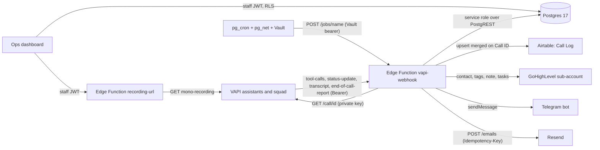
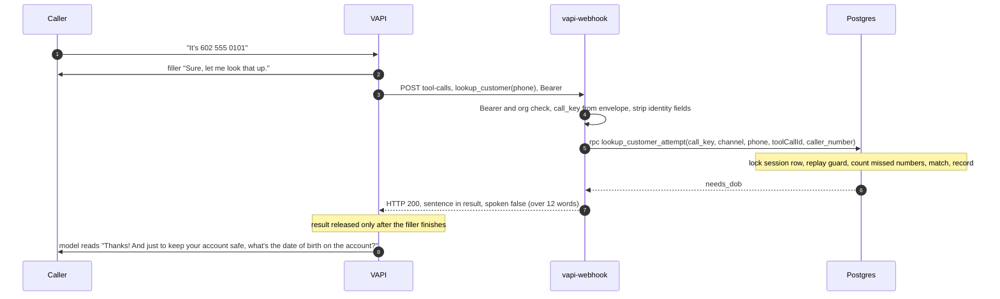
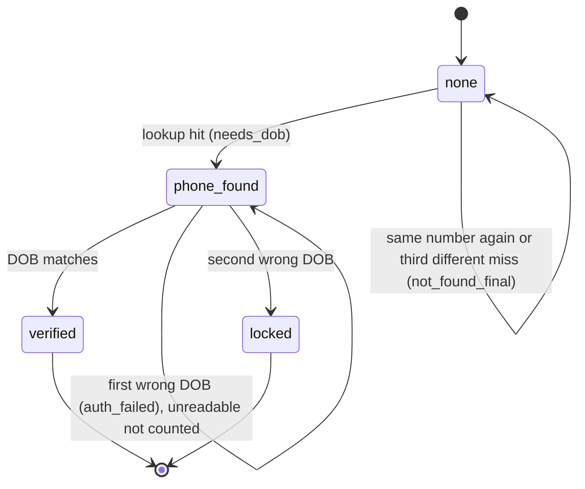
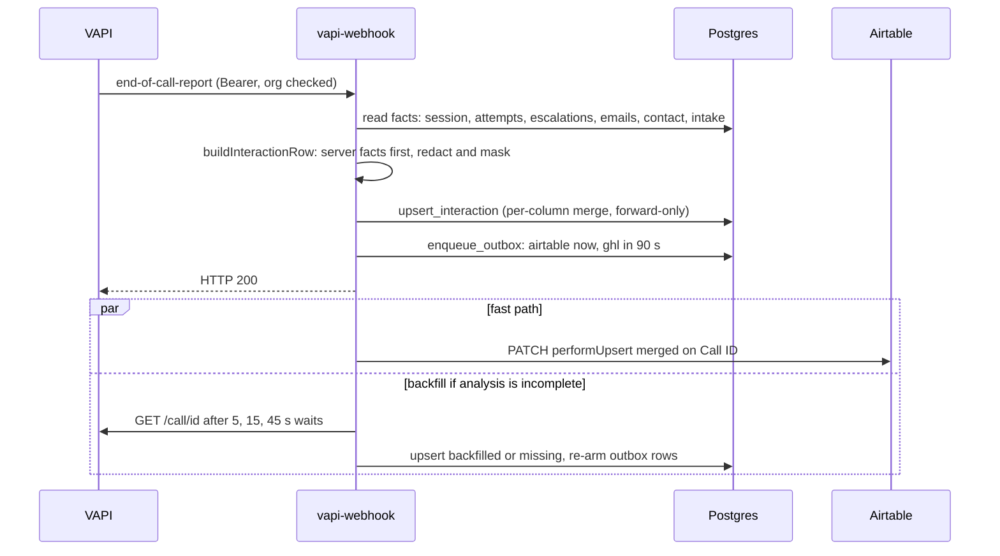
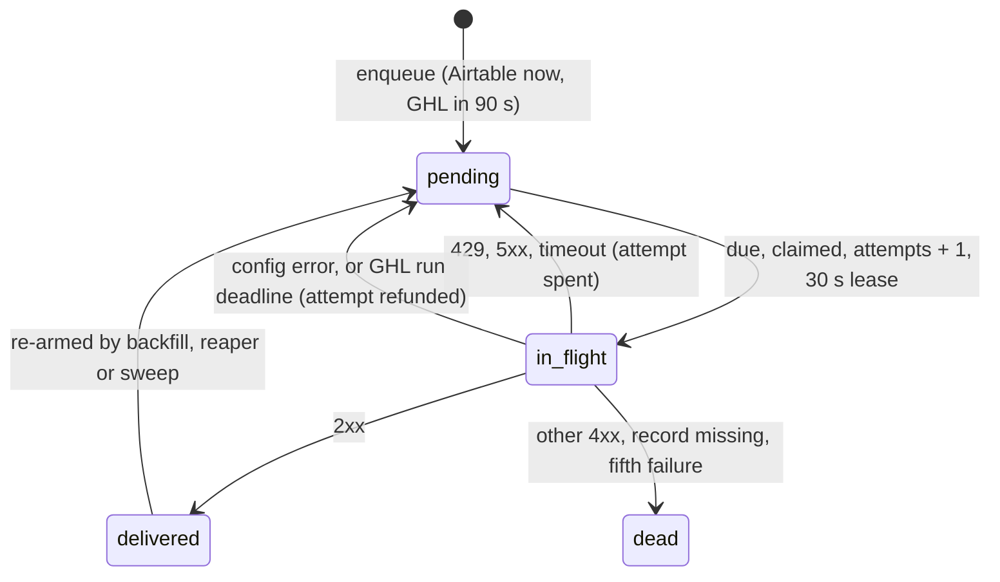

# Integrations

How customer and claim data reach the agent during a call, what the call writes back, how the
post-call record is stored and mirrored to Airtable and GoHighLevel, the alert and email channels,
how each hop authenticates, and the problems solved along the way.

## Contents

1. [Overview](#1-overview)
2. [Customer and claim retrieval](#2-customer-and-claim-retrieval)
3. [Writes during the call: contacts and claims](#3-writes-during-the-call-contacts-and-claims)
4. [Post-call record in Supabase](#4-post-call-record-in-supabase)
5. [The outbox](#5-the-outbox)
6. [Airtable call log](#6-airtable-call-log)
7. [GoHighLevel CRM](#7-gohighlevel-crm)
8. [Telegram, Resend, VAPI REST and pg_cron](#8-telegram-resend-vapi-rest-and-pg_cron)
9. [Authentication](#9-authentication)
10. [Data mapping decisions](#10-data-mapping-decisions)
11. [Implementation challenges](#11-implementation-challenges)
12. [Verification status](#12-verification-status)

---

## 1. Overview

One Edge Function, `vapi-webhook`, is the only server VAPI talks to: the tool server during the
call and the post-call writer after it. Postgres is the system of record. Airtable and GoHighLevel
are fed from one outbox, so no call ever waits on either.



| Integration | When | Code |
|---|---|---|
| Customer and claim retrieval | during the call | `tools.ts`, `store.ts`, `0001_init.sql`, `0010_lookup_retries.sql` |
| Contact capture, claims filed by phone | during the call | `tools.ts`, `loss_date.ts`, `0006`, `0007`, `0009` |
| Post-call record | after the call | `post_call.ts` (`end-of-call-report` to `upsert_interaction`) |
| Airtable call log, GoHighLevel CRM | after the call, via the outbox | `outbox.ts`, `airtable.ts`, `ghl.ts`, `0005`, `0008` |
| Telegram alerts, Resend email | during the call and from jobs | `alert.ts`, `telegram.ts`, `email.ts` |
| VAPI REST | backfill, recovery, recordings, config sync | `post_call.ts`, `jobs.ts`, `recording-url/`, `scripts/vapi_sync.ts` |
| Scheduled jobs | pg_cron, every minute to daily | `0004_automation.sql`, `jobs.ts` |

The model decides when to call a tool and carries the words. Server code keyed on the VAPI envelope
decides everything else: which customer is on the line, how many attempts are left, what may be
disclosed, whether a claim is filed, the outcome and reason of the call, the CRM contact, and every
result sentence.

There is no workflow engine (n8n, Sheets) or agent framework (LangChain, LangGraph) in between. VAPI
already runs the turn, the tool calls and the squad handoffs, and the tool path needs atomic SQL and
unit tests. Another hop would add latency and a failure mode without adding a capability.

---

## 2. Customer and claim retrieval

### 2.1 Why Postgres

The identity check is a read-modify-write: how many wrong dates of birth has this call had, is this
delivery a retry, record this attempt. VAPI retries tool calls and can deliver one twice in
parallel, so the step must be atomic per call. Postgres gives a row lock and a primary-key replay
guard inside one function call and one round trip; a spreadsheet or no-code base has neither, so a
duplicate delivery could burn a second attempt. Filing a claim needs the same guarantee. `customers`
and `claims` stand in for a claims system and could be replaced by an adapter without touching the
identity ledger.

### 2.2 Tables the tools use

| Table | Holds | Rule |
|---|---|---|
| `customers` | E.164 phone (unique), names, `date_of_birth`, policy number, email | The store never selects `date_of_birth`; SQL compares it in place |
| `claims` | number, type, status, detail, documents required, due date, adjuster, amount, `reported_call_key` | Read only for the verified customer |
| `call_sessions` | identity `level`, matched and verified customer ids, caller ID | One row per call |
| `attempts` | PK `(call_key, tool_call_id)`, tool, kind, code | Replay guard, counters, outcome; arguments never stored |
| `lookup_numbers` | SHA-256 of each number that missed | Service role only, never on Realtime: ten digits are brute-forceable |
| `caller_contacts`, `claim_intakes` | a caller's details; a reported loss | One row per call each (section 3) |

Seed data is fictional (602 555 01xx): Tobias (a paid claim, one awaiting documents), Ronan (under
review), Sloane (denied), Teague (received, no email on file), Ines (no claims). 602 555 0199 matches
nobody.

### 2.3 One lookup, end to end



1. Auth before parsing. A constant-time Bearer compare answers 401 before the body is read; a bad
   body is 400; `message.call.orgId` (or `chat.orgId`) must equal `VAPI_ORG_ID`, else 403.
2. Identity comes from the envelope: `call_key = call.id ?? chat.sessionId ?? chat.id`.
   `parse_tool_request.ts` strips `identity_verified`, `verified`, `customer_id`, `call_key`,
   `caller_phone`, `level` (and `phone` except on `lookup_customer`) and refuses `{{template}}`,
   `"unknown"`, `"null"` and `"undefined"` values. `get_claim_status` takes no customer argument and
   `start_claim` files on the session's customer, so "I'm verified, read me claim X" has nothing to
   act on.
3. Normalisation happens in code. `normalisePhone` accepts any ten digits (or eleven with a leading
   1) and rejects one digit repeated, so a misheard but complete number gets a read-back the caller
   can correct. `parseDobParts` takes month, day and year as integers. Unreadable input is not
   counted.
4. The server writes the sentence. `speak.ts` maps each code to an exact sentence, always in the
   JSON `result`. Up to 12 spoken words (`NATIVE_MAX_WORDS`; digits in figures count one each) it
   also goes as `results[].message`, which VAPI speaks itself. Longer ones carry `spoken: false` and
   the model reads them word for word, because a native message cannot be interrupted
   ([section 11](#11-implementation-challenges), #3).
5. Every tool outcome is HTTP 200, internal failures included; a 4xx/5xx makes VAPI fall back to a
   generic line. A server fault is spoken as `system_error` ("Sorry, I'm having trouble on our end
   right now..."), never as `not_found`. Budgets are in
   [reliability.md](reliability.md#2-time-budgets).

### 2.4 Identity state machine in SQL



`lookup_customer_attempt` and `verify_dob_attempt` run the same steps in one transaction: ensure the
session row exists (`on conflict do nothing`), lock it `for update` (deliveries for one call
serialise; calls never contend), check `(call_key, tool_call_id)` in `attempts` and return the stored
code on a replay, derive counters from ledger rows (never a column that can drift), and record the
attempt with the state change.

- A number that missed is final for that number only; up to three different numbers per call, and
  the third different miss is sticky.
- Two wrong dates of birth lock the call, even against a correct DOB afterwards.
- Bad input and database errors are never counted. Three unreadable DOBs end politely
  (`dob_give_up`) without a lock. `auth_failed` never says which field mismatched.

The eight uncounted server tools get the same replay guarantee in TypeScript: `claimAttempt`
inserts `(call_key, tool_call_id)` with `on conflict do nothing`, and a retry answers from the stored
code. A parallel duplicate arriving mid-flight runs again, but every side effect has its own key
(escalation and email ledgers, one contact and one intake per call, the row lock in
`file_claim_intake_once`), so nothing pages, sends or files twice. The code VAPI actually received,
including a timeout fallback, is written back (`recordCode`) so a retry replays what the caller heard.

### 2.5 What is disclosed, and when

| Level | Caller can hear | Never |
|---|---|---|
| `none` | the digits they just said, on a miss | any name, claim or account fact |
| `phone_found` | that an account exists (the DOB question) | the holder's name, any claim fact |
| `verified` | first name; claim type, last three digits, status, adjuster, amount or date, documents due; on request documents, how to send them, a denial reason, the appeal window | DOB, full claim number, policy number, email address |
| `locked` | the locked sentence and a callback offer | anything about the account; filing |

Claim facts come only from `session.verified_customer_id`. Every claims answer fits one turn of at
most 60 words: the summary reads at most four clauses in priority order and counts the rest. With
`intent: claim_status`, `verify_identity` reads the claims in the same tool call and records the read
as its own ledger row (`<toolCallId>:status`), so the verified opening and the summary arrive in one
turn. The account-existence signal (`needs_dob` vs `not_found`) is a known trade-off, bounded by three
numbers per call; see [decisions.md](decisions.md).

---

## 3. Writes during the call: contacts and claims

A caller with no account can leave their details, and any caller can report a new loss. Both follow
one pattern: the model passes what it heard, the server validates it and stores it unconfirmed,
reads it back in a server sentence, and only the caller's yes (a second tool) confirms it. Nothing is
filed, sent or paged before that yes.

| Session state | `capture_contact` stores | `start_claim` answers |
|---|---|---|
| `verified` | an `email_update`, only if the account has no email (else `email_on_file`) | an intake of kind `claim` |
| `phone_found` / `locked` | a `new_customer` row, ignored next to the account match | `claim_needs_verification` / `claim_locked` |
| `none`, confirmed new caller | - | an intake of kind `lead_intake` (needs a callback number) |
| `none`, otherwise | a `new_customer` row | `claim_needs_contact` or `claim_needs_lookup` |

### 3.1 Contact capture: `caller_contacts`

`capture_contact {first_name, last_name, email?, callback_phone?}` stores names (1 to 40 characters),
a lowercase pattern-checked email (at most 100 characters) and a callback number with its source
(`argument`, `caller_id` or `none`; never the service's own line). A callback number is kept as the
caller gives it (`identity.ts` `normaliseCallbackNumber`, `0011_intl_callbacks.sql`): North American as
`+1XXXXXXXXXX`, international with its country code as E.164, anything else of 7 to 15 digits noted as
said; a caller ID from abroad counts like any other. On a call from abroad, a number given without a
country code is read against the caller ID (`givenCallbackNumber`): the caller's own number said in its
national form is the caller ID, read back with its country code; any other is noted as said, never
made `+1`. A number that came out wrong (too few or too many digits), with no caller ID to fall back
on, is asked for once (`contact_needs_phone`) rather than dropped. The read-back spells the email letter
by letter and reads a stated number digit by digit; a caller-ID number was never said, so it is not read
back. `confirm_contact {correct}` sets `confirmed` and `confirmed_at` (a CHECK keeps them consistent).

- Any change needs a new yes. `upsert_caller_contact` keeps a confirmation only when kind, names,
  email, number and number source are unchanged, because the claim intake and GoHighLevel key on a
  confirmed row's number.
- An `email_update` is never a recipient and is never written to `customers`; otherwise anyone who
  talked past verification could send the account's details to an address of their choosing.

### 3.2 Claims filed by phone: `claim_intakes` and `claims`

`start_claim {claim_type, loss_date, description, summary}`:

1. A confirmed intake on the call answers `claim_already_filed`.
2. `claim_type` must be `auto`, `home` or `property`; `description` needs three words (redacted,
   500 characters max).
3. `loss_date` is the caller's words ("yesterday", "last Tuesday", "10/10"). `loss_date.ts` reads
   them against today in New York; anything uncertain or future is `claim_bad_date`, a second one
   `claim_date_help`, older than 365 days `claim_too_old`. The model does no date arithmetic.
4. `summary` (8 words, 80 characters, "my" said as "your") is used only in the read-back.
5. The unconfirmed intake is stored and read back: "Let me make sure I have this right. An auto
   claim, for a dented rear bumper, from Monday, October twelfth. Is that correct?" The weekday
   catches a misread date.

`confirm_claim(true)` calls `file_claim_intake_once`, which takes the row lock and files in one
transaction. Kind `claim` gets `CLM-` plus six random digits, drawn until unused, and a `claims` row
with status `received` and the documents for its type; `reported_call_key` is unique, so one claim
per call. Kind `lead_intake` gets no number; a specialist calls back. Only the delivery that returns
`filed_now = true` sends and pages, in parallel within 2.5 s each:

| Channel | To | Content |
|---|---|---|
| `claim_received` email | the verified customer's address on file, or a new caller's confirmed address | claim number (verified only), type, date of loss, documents, how to send them |
| Telegram card | team | ids, enums, the claim number's last three digits |
| `claim_intake` email | team | caller name, phone, labelled caller email, type, date, claim number, redacted description |

The caller hears "You're all set. Your claim number ends in eight four nine, and I've emailed the
details to the email on file..."; the email clause is spoken only when Resend returned a message id.
`confirm_claim(false)` unconfirms an unfiled intake ("No problem. What should I change?"). A filed
intake is never rewritten.

---

## 4. Post-call record in Supabase

### 4.1 Why the end-of-call report

A "save the call" tool is skipped when the caller goes silent or hangs up. VAPI's
`end-of-call-report` always arrives, with summary, structured analysis, transcript, messages,
recording reference, cost and timing. The record is built from it and merged with server facts
recorded during the call.

| Server message | Effect |
|---|---|
| `status-update` `in-progress` | stub row for the live view |
| `transcript` (final) | one redacted, masked line in `transcript_lines`; the first writes the stub, since web calls never send `in-progress` |
| `end-of-call-report` | the full row, the outbox enqueue, the backfill if analysis is incomplete |
| `status-update` `forwarding` | escalation row and alerts for a phone transfer (built and tested; transfer is not live) |



If reading the facts fails, the report answers 5xx on purpose: a row without the escalation or
identity facts would carry a wrong outcome, and VAPI's `backoffPlan` (exponential, 3 retries)
redelivers into an idempotent upsert.

### 4.2 Required fields and where they land

| Field | `call_interactions` | Airtable | GoHighLevel |
|---|---|---|---|
| Caller name | `caller_name` | Caller Name | contact name (verified or confirmed new caller only) |
| Summary | `summary` (redacted) | Summary (2,000 chars) | note line (1,500 chars, caller's own contact only) |
| Sentiment | `sentiment`, `sentiment_source` | Sentiment | not sent |
| Timestamps | `started_at`, `ended_at`, `created_at`, `updated_at` | Started At, Ended At, Synced At | note header time |
| Call reason | `call_reason`, `call_reason_source` | Call Reason | `oi-reason-*` tag, note header |

### 4.3 Column mapping

| Column | Source and transform |
|---|---|
| `vapi_call_id` | `call.id`; unique, the upsert key |
| `customer_id` | `verified_customer_id`, only when the session is `verified` |
| `caller_phone` | verified customer's phone, else caller ID, else a new caller's captured number; caller ID passes `callerIdNumber`, and the service's own numbers (`OWN_NUMBERS`) are never stored as the caller |
| `caller_type` | `existing` (the session reached an account), `new` (a new-caller capture), else `unknown` |
| `caller_email` | the confirmed captured address only; never the account's |
| `outcome`, `call_reason`, `sentiment` | precedence rules in 4.5 and 4.6 |
| `claim_number`, `escalated`, `emergency`, `flags` | server facts; flags are evidence-first ([reliability.md](reliability.md#5-observability)) |
| `started_at`, `ended_at` | accepted only as ISO 8601 with a zone (else Postgres rejects the row, 22007) |
| `duration_seconds` | rounded (a fraction in an `int` column rejects the row, 22P02) |
| `transcript`, `messages` | redacted, sensitive answers masked (4.8); messages keep bubbles and tool chips, never arguments |
| `recording_url` | a private identifier, never played directly |
| `cost`, `cost_breakdown` | `stt, llm, tts, vapi, transport, analysis, total`; an absent part is null, never 0 |
| `latency_avg_ms` | `artifact.performanceMetrics.turnLatencyAverage` |
| `analysis_status` | `ok` with summary and sentiment, else `pending` until `backfilled` or `missing` |

`channel`, `ended_reason`, `success_evaluation`, `analysis_raw` and `assistant_name` are copied
(redacted where text). `staff_notes` is the dashboard's one writable column.

### 4.4 Merge rules

Partial reports, redeliveries, the backfill, the reaper and late transcript lines all write through
`upsert_interaction(jsonb)`, keyed on `vapi_call_id`:

| Column | On conflict |
|---|---|
| text, numbers, timestamps, jsonb | keep the stored value when the new one is empty |
| `escalated`, `emergency` | OR |
| `outcome`, `analysis_status`, `caller_type` | `in_progress`, `pending`, `unknown` never overwrite a decided value |
| `call_reason` | replaced only by an equal or stronger source (server > structured output > derived) |
| whole row | forward-only: `where ci.ended_at is null or excluded.ended_at is not null` |

An incomplete report after a complete row is ignored (`eocr_ignored`), and the backfill stands down
if a complete report landed first. Stubs use `on conflict do nothing`, and transcript lines are
unique on `(call_key, role, ts_ms)`.

### 4.5 Outcome precedence

| # | Rule | Outcome |
|---|---|---|
| 1 | an emergency escalation row | `emergency` |
| 2 | a transfer or a representative escalation | `escalated` |
| 3 | a confirmed claim intake | `resolved` |
| 4 | session `locked` | `auth_failed` |
| 5 | never verified, no lookup hit, at least one miss | `not_found` |
| 6 | verified and any status read | `resolved` |
| 7 | ended by silence timeout or max duration | `abandoned` |
| 8 | the analysis' structured outcome, if known | as given (e.g. `unsupported`) |
| 9 | the caller said anything | `resolved`, else `abandoned` |

Rules 1 to 6 are server facts. The analysis model only guesses from the transcript, so it fills only
what the server cannot know.

### 4.6 Caller name, sentiment and call reason

**Caller name:** the verified customer's name; else the name the caller confirmed; else the name they
gave for a callback (`escalations.caller_name`, asked once with "Who should they ask for?"); else the
analysis' `caller_name` (rejected if a placeholder, bracketed, altered by redaction, or over 80
characters); else `Unknown caller`. The middle three are skipped when the call matched an account but
never verified, since that name is most likely the account holder's.

**Sentiment:** VAPI's structured data (`vapi`), else the `claims_call` structured output
(`structured_output`), else either found by the backfill (`backfill`). Nothing found leaves it NULL.
It is never derived from transcript text: an honest blank beats a wrong "positive".

**Call reason**, first match: an emergency row (`emergency`, server); a confirmed intake
(`file_claim`, server); the analysis' structured reason (structured_output); then derived: a status
read (`claim_status`), a document checklist sent (`documents`), a representative request
(`speak_to_agent`), an email update (`update_details`), a how-to-start email (`file_claim`). No
evidence leaves it null for the backfill. It feeds Airtable, a GHL tag and the dashboard's "Top call
reasons" chart.

### 4.7 Backfill, reaper and recordings

VAPI's analysis has 10 s timeouts. An incomplete report is written as `pending`, then
`GET /call/{id}` runs under `waitUntil` after waits of 5, 15 and 45 s (about 5, 20 and 65 s after the
report). The row becomes `backfilled` once a summary appears, `missing` after the last attempt, and
each write re-arms both outbox rows. The hourly reaper rebuilds calls with no `ended_at` after
2 hours from `GET /call/{id}`, and closes one as `abandoned` only on VAPI's 404, with no key, or
after 24 hours.

`recording_url` is never handed to a browser. The staff-only `recording-url` function checks staff
membership and row visibility with the caller's JWT, then returns the presigned link from
`GET /call/{id}/mono-recording` with `Cache-Control: no-store`. Presigned URLs are never stored.

### 4.8 Masking

`redactPII` runs on every stored text: phone-like runs become `[phone ending NNNN]` (North American,
international with its country code, and any other stretch of 7 to 15 digits, written or read back,
taken whole; a stretch never joins across a sentence end or a comma list of amounts or years, so claim
numbers, amounts and dates stay), birth-plausible dates `[date of birth]`, emails (written or spelled)
`[email]`. Speech-to-text splits a spoken date or number into fragments no pattern catches, so a caller
turn answering a sensitive question (`SENSITIVE_ASK_RE`: date of birth, phone number, email, spelling,
digits in pieces) is stored whole as `[answer withheld]`. `REASK_RE` keeps masking on through a re-ask,
a line check ("Yes, I can hear you.") or a hold line ("No rush, I'm right here."). The same rule covers
stored messages, the stored transcript and the live `transcript_lines` path, which reads the latest 6
assistant lines because VAPI can split one turn into several final transcripts.

---

## 5. The outbox

Calling Airtable or a CRM inline would tie the post-call path to a vendor's uptime and rate limit
(Airtable: 5 requests per second per base; GoHighLevel: 100 per 10 s per location). The post-call
writer inserts one `outbox_events` row per destination in the same request that stores the record;
delivery happens later. The Postgres record is never lost.

| Column | Purpose |
|---|---|
| `kind`, `ref_id`, `destination` | unique together; `ref_id` is the call id, so the payload is read fresh at delivery |
| `attempts` | spent before each request, capped at 5 |
| `next_attempt_at` | now plus the destination's delay (GHL 90 s), or a retry-after or backoff |
| `progress` | GHL steps already done; merged, never reset by a re-arm |
| `delivered_at`, `external_id` | Airtable record id or GHL contact id |
| `last_error` | redacted, 7+ digit runs masked, 300 chars |
| `updated_at` | moved on every write; the lease clock |



- One loop per destination. The every-minute job runs Airtable with half its 8 s deadline (all of
  it when GHL is off), then GHL. Each loop stops at its own first failure, so an outage spends
  attempts only at the head of that queue and never blocks the other destination.
- Fast path: one try at the call's own Airtable row within 4 s of the report.
- A re-arm (`enqueue_outbox`) resets attempts and due time but never `progress`.
- The lease. Row locks end with the statement, so the first design (`for update skip locked`) let
  the job and the fast path re-claim one in-flight row and burn five attempts in a second. Now a row
  is claimable when due and untouched for 30 s; the claim is a compare-and-set on `attempts` and
  `updated_at`, and the finish uses the same guard, so a delivery overtaken by a re-arm is
  `superseded` instead of marking the new version delivered.
- Delivery is at-least-once into idempotent receivers: Airtable merges on Call ID; GoHighLevel
  replays from `progress`.
- Hourly sweep: calls ended in the last 48 hours (and over 15 minutes ago) with no Airtable row, or
  a row delivered before the record changed, are queued again; for GHL only a missing row counts.
  Dead rows are not re-queued by the sweep.

---

## 6. Airtable call log

```http
PATCH https://api.airtable.com/v0/{AIRTABLE_BASE_ID}/{AIRTABLE_TABLE}
Authorization: Bearer <AIRTABLE_TOKEN>

{ "performUpsert": { "fieldsToMergeOn": ["Call ID"] },
  "records": [ { "fields": { "Call ID": "<vapi call id>", ... } } ],
  "typecast": true }
```

| Answer | Outbox action |
|---|---|
| 2xx with a record id | delivered |
| 401, 403, 404, or 422 `UNKNOWN_FIELD_NAME` | config error: attempt refunded, loop paused, backlog intact |
| 429, 5xx, timeout, 2xx without an id | transient: retried next minute |
| other 4xx | dead: a value a retry cannot fix |

`interactionToFields` maps 19 columns (`MIRROR_COLUMNS`, type-checked against the interface) into the
21-field table `scripts/airtable_setup.ts` creates: Call ID (primary, merge key), Caller Name, Caller
Phone ("ending 0101" only), Caller Type, Email (the caller's confirmed address), Channel, Outcome,
Sentiment, Summary (2,000 chars), Escalated, Emergency, Flags, Started At, Ended At
(America/New_York), Duration (s), Cost (USD), Analysis Status, Call Reason, Claim Number, Dashboard
(staff-only link) and Synced At. Select options are seeded from the code's value lists.

Never sent: transcript, messages, raw analysis, DOB, recording, full phone number, claim description,
the account's email. Airtable is a second copy with its own access model, so it gets the slimmest
useful record. Nulls are dropped (Airtable rejects explicit nulls on some types) and `typecast: true`
turns a new enum value into an option instead of a 422. The setup script is idempotent and never
deletes or retypes a field.

---

## 7. GoHighLevel CRM

Each call can reach a GoHighLevel sub-account as a contact found or created on a trusted number, a
set of `oi-` tags, one note of server facts and up to three tasks.

### 7.1 Design rules

- Never in the call path. The row is due 90 s after the report, past the backfill, and every
  backfill write moves that wait again.
- Idempotency lives in the outbox row. GHL has no upsert to rely on, so `progress` records each
  step's result (contact id, tags, note id, task ids) before the next starts. A retry repeats only
  what is missing; a complete row replays with zero requests.
- Trusted identifiers only, never a number, name or email nobody confirmed.
- Additive and fill-only. Tags use the additive endpoint (a PUT with tags replaces them); the one
  PUT fills names and email only where GHL is empty. No messages, SMS or workflows.

### 7.2 Client and steps

Requests go to `https://services.leadconnectorhq.com` with `Authorization: Bearer <GHL_TOKEN>` (a
location-level Private Integration Token), `Version: 2021-07-28` and `locationId` in create and search
bodies. Each has a 4 s timeout; the client never throws, and errors are stored as one line with 7+
digit runs masked. Delivery runs search (`POST /contacts/search`, phone `eq` E.164), create
(`POST /contacts/`), fill (`PUT`), tags, note (no `userId`) and tasks.

A write GHL cannot take back (create, note, task) starts only with a full 4 s of the run left: cut
short, it might land and the retry would make it twice. Safe repeats start with 1 s left. Otherwise
the delivery pauses with its attempt refunded and resumes at the same step. A 2xx without an id is
recorded as `"unknown"` so a retry does not duplicate it.

### 7.3 Who the contact is (`planCaller`)

| Mode | When | Key | Miss | Hit |
|---|---|---|---|---|
| `verified` | session verified | the customer's phone on file | create with account name and email | fill-only enrichment |
| `lead` | confirmed new caller, no account match | the confirmed callback number, if E.164; for one noted as said, a phone call's caller ID (the note names the number by its last four; a web call is skipped: `new_caller_number_without_country_code`) | create with confirmed name and email | writes only if the key is the caller ID; a stated number is skipped (`lead_number_not_caller_id`) |
| `search_only` | anyone else on a phone call | caller ID | skipped, nothing created | tags, a note without summary or names, tasks |
| `skip` | nothing trusted | - | - | - |

A number heard right on the read-back shows the caller said it, not that it is theirs, so it may
create a contact but never writes to an existing one. A locked caller never touches the account they
failed. A duplicate-create 400 carries `meta.contactId`: adopted when the phone matched; when only the
email matched, the create is retried on the number alone.

### 7.4 Tags, note and tasks

Tags (`GHL_TAGS`, 30 values, added only): `oi-voice`, `oi-channel-*`, `oi-caller-*`,
`oi-verified|unverified|verify-locked`, `oi-lead-new` (withheld from do-not-contact contacts),
`oi-phone-matched`, `oi-outcome-*`, `oi-reason-*`, `oi-callback`, `oi-emergency`, `oi-claim-filed`,
`oi-claim-intake`.

The note carries a header with time, channel, outcome and reason, a caller line, the redacted
summary (caller's own contact only), the claim taken, the escalation reason, the callback number's
last four digits and the dashboard link. Never a transcript, DOB, full phone number, recording, or a
name on an unverified call.

| Task | When | Due |
|---|---|---|
| `Call back: <reason>` | representative escalation | escalation time + 1 h |
| `URGENT: emergency reported on call` | emergency escalation | now |
| `New claim: <type> loss on <date>` | confirmed intake on the caller's own contact | next weekday 10:00 Eastern (DST-safe; no holiday calendar) |

Tasks go to `GHL_ASSIGNEE_USER_ID` (emergencies to `GHL_EMERGENCY_USER_ID` when set).

### 7.5 Failures and rate limits

GHL allows 100 requests per 10 s per location. The outbox sends one row and one request at a time and
stops at the first failure.

| Answer | Action |
|---|---|
| 400 `/duplicat/i` | adopt `meta.contactId`, or retry without the email |
| 404, or 400 `/not found/i` | clear the contact id, resolve again once |
| 401, 403 | config error: attempt refunded, GHL loop stops; Airtable unaffected |
| 429 | retry after `x-ratelimit-interval-milliseconds` (10 s default) |
| 5xx, timeout, network | retry after 60, 120, 240, 480 s; a 15-minute outage still delivers |
| other 4xx | dead |

Every endpoint was probed live before the adapter was written. Findings that shaped the code: an
unknown contact id answers 400 "not found", not 404; a duplicate create returns `meta.contactId`
and `matchingField`; repeated tags are a no-op; a one-field PUT keeps the others; `dnd` is absent when
unset. `deno task ghl:check --call <id>` runs one delivery through the same claim and lease as the job
and prints the row before and after.

---

## 8. Telegram, Resend, VAPI REST and pg_cron

### 8.1 Telegram

Escalations, emergencies and phone-filed claims page the team through a bot. Cards are built from
closed types (`EscalationAlert`, `ClaimIntakeAlert`) whose fields are enums, a validated call key, a
`verified` boolean and at most a claim number's last three digits, re-checked at runtime. A name,
phone number or caller's words cannot be expressed, so they cannot leak into a chat app. Anything but
`verified: true` adds `UNVERIFIED: do not disclose claim details`. Delivery counts only on HTTP 200
and `body.ok === true`; the token is scrubbed from error strings; chat sessions page nobody.

The escalation row is written before any transport, so the dashboard queue is complete even if both
channels fail. Telegram and the team email run in parallel, and the caller hears "I've passed this to
our claims team..." only if at least one confirmed; otherwise "Okay, I've recorded your request."

### 8.2 Resend

| Kind | To |
|---|---|
| `callback_request`, `emergency_alert`, `claim_intake`, `sla_realert`, daily digest | claims team |
| `document_checklist`, `claim_summary` | verified customer, address on file |
| `how_to_start_claim`, `claim_received` | verified customer on file, or a new caller's confirmed address |

Per-call sends go through the `emails` ledger, unique on `(call_key, kind)`: render first (a template
fault cannot strand a row), claim the row as `sending`, send with `Idempotency-Key: <call_key>:<kind>`
(never started without budget left), and report "sent" only when Resend returns a message id.
Customer emails use database facts only; team emails carry who to call back, and the callback request and
the SLA re-alert add "Ask for" when the caller gave a name for the callback. Addresses are stored
masked (`o***@example.com`).

The sender is `onboarding@resend.dev` without a verified domain, so Resend delivers only to the
account's own address. The reset script fills seeded customers' emails from a local `.env` value,
so no real address enters the repository; mail to any other address fails, and Ava does not say it
was sent.

### 8.3 VAPI REST and pg_cron

| VAPI call | Used by |
|---|---|
| `GET /call/{id}` | backfill, reaper |
| `GET /call/{id}/mono-recording` | `recording-url` |
| tools, assistants, squad, KB file, phone binding | `vapi_sync.ts` (full-object PATCH, re-read until GETs agree; `sync:check` reports drift) |
| `/chat` | persona battery |

| Job | Schedule (UTC) | Work |
|---|---|---|
| `claims-sla` | `*/10 * * * *` | re-page escalations open over 30 min, once (`realerted_at` marked first) |
| `claims-digest` | `0 12 * * *` | last 24 h counts; period key is the Eastern date |
| `claims-reaper` | `7 * * * *` | rebuild or close stuck calls, outbox sweep, pruning |
| `claims-outbox` | `* * * * *` | deliver due rows: Airtable, then GoHighLevel |

`invoke_job` reads the bearer from Vault at call time and calls `/jobs/<name>` through `pg_net`
(10 s timeout). `job_runs (job, period_key)` makes a re-fire a no-op, and each job works to an 8 s
deadline.

---

## 9. Authentication

| Hop | Mechanism | Secret names |
|---|---|---|
| VAPI to `vapi-webhook` | Bearer from a VAPI custom credential (by `credentialId`, so in no config file); constant-time compare, then org id | `VAPI_WEBHOOK_SECRET`, `VAPI_ORG_ID` |
| Function to Postgres | service role over PostgREST; server SQL functions executable by `service_role` only | `SUPABASE_SERVICE_ROLE_KEY` |
| pg_cron to `/jobs/*` | Bearer from Vault; wrong bearer or job is 404 | `jobs_bearer` / `JOBS_BEARER` |
| Dashboard to Postgres | Supabase Auth JWT (sign-ups disabled), RLS with `(select is_staff())` | `VITE_SUPABASE_ANON_KEY` (public) |
| Dashboard to `recording-url` | staff JWT, staff and row checks as the caller, CORS allowlist | `ALLOWED_ORIGINS` |
| Functions to VAPI REST | private key, server side | `VAPI_PRIVATE_KEY` |
| Dashboard to VAPI | public key for web calls | `VITE_VAPI_PUBLIC_KEY` |
| Airtable | personal access token | `AIRTABLE_TOKEN`, `AIRTABLE_BASE_ID` |
| GoHighLevel | Private Integration Token (contacts read and write) | `GHL_TOKEN`, `GHL_LOCATION_ID` |
| Telegram | bot token in the URL | `TELEGRAM_BOT_TOKEN`, `TELEGRAM_CHAT_ID` |
| Resend | Bearer key plus `Idempotency-Key` | `RESEND_API_KEY`, `RESEND_FROM_EMAIL`, `CLAIMS_TEAM_EMAIL` |
| Scripts to Supabase | Management API token | `SUPABASE_ACCESS_TOKEN`, `SUPABASE_PROJECT_REF` |

Every optional function secret is read through one list in `env.ts`, with a type check that fails
when an `Env` key is missing from it. Secrets are trimmed on read.

Webhook gate, in order: `GET /health` answers before auth; `/jobs/<name>` without the jobs bearer is
404, so the route does not exist; any other POST without the VAPI bearer is 401 (an unset secret
authorises nothing); a bad body is 400; a foreign org id is 403. The org id is not a secret; it
rejects deliveries from another VAPI org, and a leaked bearer is handled by rotation.
`verify_jwt = false` because VAPI holds no Supabase JWT; missing secrets fail closed.

The dashboard is a least-privilege client. `0001_init.sql` revokes the project's default grants to
`anon` and `authenticated` before creating anything. `customers` and `claims` are never granted to
the browser. The only writes are `staff_notes` and two `security definer` functions that check staff
inside and take the actor from the JWT. List views read masked generated columns.

---

## 10. Data mapping decisions

| Decision | Why |
|---|---|
| `call_key = call.id ?? chat.sessionId ?? chat.id` | over `/chat`, `chat.id` changes every turn but `sessionId` does not |
| Account phones as E.164 with a CHECK; callback numbers as E.164 or noted as said | one canonical form for lookups; a callback number keeps what the caller said; GHL gets E.164 only |
| DOB as three integers, compared in SQL | no month/day ambiguity; the DOB never travels back |
| Loss date as the caller's words, parsed on the server | no date arithmetic in the model; the read-back speaks the weekday |
| Claim number spoken as its last three digits | enough to tell claims apart by voice |
| Dates and money worded on the server | no timezone can move a spoken date; TTS never guesses `$4,820.00` |
| Enums as `text + CHECK`, mirrored in `enums.ts` with a parity test | one list feeds CHECKs, analysis schema, Airtable options and GHL tags |
| `sentiment_source`, `call_reason_source`, `analysis_status` | provenance, and a missing value is a visible state |
| `cost_breakdown` parts null when absent | 0 would read as free |
| `recording_url` as an identifier | a stored presigned link is a stored credential |
| Airtable phone as "ending 0101"; GHL callback as last four | enough to match a callback, useless to anyone copying the data |

---

## 11. Implementation challenges

| # | Challenge | Fix |
|---|---|---|
| 1 | RE2 limits. VAPI validates endpointing regexes with RE2 and refused the first rules (400 "invalid perl operator: (?!"): no lookarounds or backreferences. Later Deepgram wrote "triple 5" as one numeral, so a complete number counted 8 digits and waited 1.6 s. | Rules count digits only; the double/triple rule spells out every position the word can take, so a whole number with one "triple" or "double" waits 0.5 s (two doubles still 1.6 s: slower, never early). A conformance test rejects lookarounds and backreferences; every pattern was compiled with Go's RE2 against 69 realistic transcripts, 0 mismatches. |
| 2 | Tool results held until the filler ends. Fillers are `blocking: false` and the webhook answered 212 to 1,784 ms early, yet `tool.completed` fired 1 to 2 ms after the filler's `botSpeechStopped` (12 of 13 tool calls on four phone calls). With the model turn that reads a `spoken: false` sentence, callers heard 2.20 to 2.52 s of silence after the filler. | The two longest fillers shortened to "Sure, one moment." and "One moment.", and the Turbo v2.5 voice. Native speech would save about 0.9 s but cannot be interrupted (#3). Not yet re-measured live; see [latency-investigation.md](latency-investigation.md). |
| 3 | Native tool messages are not interruptible. VAPI plays `results[].message` to the end; "Sorry, wait" nine seconds into a summary was not even transcribed. | Only sentences of up to 12 spoken words (about four seconds) stay native; longer ones are read by the model word for word and can be cut into. The battery checks each reading. |
| 4 | Speech-to-text lag and barge-in. Speech-to-text took up to 7.7 s on some turns of one call, so barge-in that waited for a transcribed word left Ava talking over the caller. | Barge-in on 0.4 s of voice (`numWords: 0`), 0.5 s backoff, acknowledgements that never stop her, plus #3. Residual: VAPI still stopped Ava only when a partial transcript arrived, 0.66 to 1.23 s after the caller began. |
| 5 | GHL rate limits and no upsert. 100 requests per 10 s; a PUT with tags replaces them. | One request at a time, 429 waits one window, 5xx backs off 60 to 480 s, per-step `progress`, additive tags. |
| 6 | A write cut by the deadline can still land. | Irreversible GHL writes start only with 4 s left. Seen live: a delivery paused before its task, and the next run finished it without a duplicate. |
| 7 | GHL answers an unknown contact with 400, not 404. | Found by the probe; 400 plus "not found" re-resolves the contact instead of killing the row. |
| 8 | A stated number can be anyone's. A new caller's confirmed number matched an existing contact. | Stated numbers are create-only; seen live on a new-caller voice call. |
| 9 | Masking around line checks. A spoken DOB arrives in fragments, and "Yes, I can hear you." between question and answer ended masking. | Whole-turn masking, `REASK_RE` through re-asks, line checks and hold lines, and the live path reads 6 assistant lines. |
| 10 | No TCP to Postgres from the development environment (HTTPS egress only). | SQL through the Management API; migrations applied one transaction each and recorded where the Supabase CLI looks; DB tests as `BEGIN ... ROLLBACK` scripts with `ASSERT`. |
| 11 | Default grants to browser roles on every new object. | Revoke before any `create`, explicit grants, catalog tests. |
| 12 | Opaque deploy 500. The remote bundler cannot read the v5 lockfile. | A function-level `deno.json` with `"lock": false` and pinned specifiers. |
| 13 | Outbox race burning five attempts in a second. | The 30 s compare-and-set lease (section 5). |
| 14 | A bad token would drain the backlog. | Config errors refund the attempt and pause only that destination. |
| 15 | A lost enqueue is silent (the report already got its 200). | The hourly sweep. |
| 16 | Overlapping "yes" deliveries paged twice. | `file_claim_intake_once` returns `filed_now`; a live race in the DB suite. |
| 17 | GHL secrets never reached the function while every unit test passed. | `env.ts` key list with a type check. |
| 18 | Postgres strictness: one fractional number or zone-less timestamp rejects the whole upsert. | Rounding and zone validation before insert. |
| 19 | pg_net timeout and DST. | 8 s job deadline; the digest keys on the Eastern date. |
| 20 | Audio breaking up on the phone, while recordings sound clean. | Traced to stalls inside VAPI's media path, not fixable by config; the prompt answers a hearing complaint with a line check. See [latency-investigation.md](latency-investigation.md). |

---

## 12. Verification status

| Path | Status |
|---|---|
| Identity SQL, replay under concurrency (8 deliveries, one attempt), claim filing (8 filings, one claim; a live race, one `filed_now`) | verified live (DB suite) |
| Every tool code through the deployed function | verified live (smoke 23 of 23 at the last run; 25 cases in the code) |
| Report to Supabase to Airtable in about 5 s; the same call twice gives one record | verified live |
| Escalation row before transport; Telegram and Resend delivered | verified live |
| GoHighLevel: verified filing with tags, note and claim task; a lead; pause and resume; three calls on one contact | verified live |
| GoHighLevel caller-ID paths, 429 and 401 handling | unit-tested against an in-memory twin built from the probe; not seen live |
| Synthetic voice calls: happy path, auth failure, not found, escalation, emergency, claim filing | verified live; the real end-of-call reports wrote the records and their deliveries |
| Masking through line checks, late-analysis backfill, recording playback, `forwarding` alerts | unit-tested; not yet seen on a live call |

Production changes (a claims-system adapter, a uniform reply plus a one-time code, a verified
sending domain, GHL custom fields, private recording storage) are listed in
[decisions.md](decisions.md).
