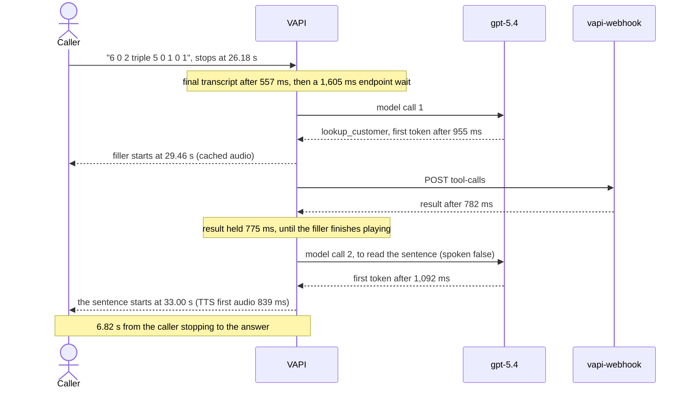

# Latency investigation: call 01a13635

On 2026-10-13 at 17:00 UTC I made a 175 s test call to the phone line, which then ran the
ElevenLabs Multilingual v2 voice. This page covers how I broke the call down, what I found, what
changed and what the next call showed.

## Symptoms

- Replies took 2 to 3 s, and some took much longer.
- Mid-call I said "your voice was breaking".
- After that, Ava sounded scripted. She said the services list again twice, ending "Does that
  help?", sent an email without a word about the line, then re-read the documents list from memory
  and closed with "Does that make sense?". I hung up at 174.5 s.

## Method

I measured before changing anything: each reply split into stages, and each delay assigned to the
hop that owns it.

| Evidence | What it gave |
|---|---|
| VAPI event log | Millisecond events per turn: `finalTranscript`, `endpointingTriggered`, `firstTokenReceived`, `firstAudioReceived`, `tool.completed`, `botSpeechStopped`, `call.driftDetected` |
| Call object | `performanceMetrics.turnLatencies`, the voice model, and the live system prompt (identical to the rendered repo prompt apart from the date line) |
| 16 kHz stereo recording | Caller and Ava on separate channels; the caller's last word timed from the waveform; Ava's channel within 20 to 60 ms of VAPI's speech events |
| Packet capture | RTCP reports for the carrier leg |
| Three comparison calls that day | `01a134e6` on Turbo v2.5, `01a13604` on Flash v2.5, `01a13617` on Multilingual v2 |

"Total" below is the time from the caller's last word to Ava's answer. On a tool turn that is the
sentence after the filler, not the filler.

## Findings

### 1. A plain reply took about 3 s, spread over five stages

Plain replies took 2.66 to 3.82 s (median 2.90 s, mean 3.10 s). VAPI's own `turnLatencyAverage` for
the call was 3,299 ms.

| Stage | Measured |
|---|---|
| Deepgram final transcript after the caller stops | 0.51 to 0.76 s (mean 0.57 s) |
| Endpointing wait | 0.42 to 0.59 s on confident turns; up to 2.875 s on a sentence that sounded unfinished |
| gpt-5.4 first token | median 0.89 s (0.65 to 1.09 s) |
| Chunking | about 0.18 s |
| ElevenLabs first audio, Multilingual v2 | median 0.84 s (0.56 to 1.05 s) |

The model's first token is a baseline, not a prompt-cache cost: requests carried 10.8k to 11.8k
prompt tokens with reasoning off, and the first request of the call, with nothing cached, was no
slower than the rest.

Per turn, in ms unless marked. "Held" is how long VAPI kept a finished tool result before
releasing it. Tool turns show two first tokens: one before the filler, one to read the result.

| Turn | Caller said | Endpoint wait | Model first token | Tool: webhook, held | TTS first audio | Total |
|---|---|---|---|---|---|---|
| T5 | "status of my claim" | 591 | 900 | - | 605 | 2.90 s |
| T13 | "6 0 2 triple 5 0 1 0 1" | 1,605 | 955, 1,092 | `lookup_customer`: 782, 775 | 839 | 6.82 s |
| T17 | "March 14 19 86" | 424 | 834, 868 | `verify_identity`: 1,316, 212 | 989 | 5.76 s |
| T21 | "what services" | 509 | 1,019 | - | 1,054 | 3.28 s |
| T22 | "Sorry. What?" | 452 | 1,035 | - | 750 | 2.66 s |
| T24 | "I am not able to listen. What?" | 465 | 653 | - | 859 | 2.86 s |
| T27 | "what document I need" | 447 | 808, 888 | `get_claim_status`: 1,183, 1,784 | 811 | 6.16 s |
| T42 | "your voice was breaking. I was not able to hear" | 2,875 | 963, 804 | `send_info_email`: 2,033, 942 | 832 | 9.38 s |
| T50 | "your voice was breaking ... not able to hear it" | 1,432 | 727 | - | 911 | 3.82 s |

### 2. Tool results waited for the filler to finish

The fillers on these tools are `blocking: false`, yet VAPI marked each tool complete 1 to 2 ms
after its filler stopped playing (30.954 s against 30.952 s on T13), although the webhook had
answered 212 to 1,784 ms earlier. The pattern held in 12 of 13 tool calls across all four calls.
VAPI then runs the model a second time to read the `spoken: false` sentence.

From the end of the filler to the answer took 2.20 to 2.52 s (mean 2.33 s): about 0.42 s of clip
tail and stop detection, 0.91 s to the second first token, 0.05 s of chunking and 0.87 s of TTS.
Tool turns took 5.76 to 6.82 s in total (mean 6.25 s), and 9.38 s on the complaint.

Two fillers were not yet in VAPI's voice cache and took about 1.1 s to start, against 46 and 78 ms
for cached ones. The cache appears to be keyed by text and voice settings (inferred), so the
first use of a filler after a voice change is slow.

### 3. Endpointing hit VAPI's 2.86 s cap

No `waitFunction` was set. From 44 logged LiveKit predictions on two of the comparison calls, VAPI's
live curve waited 2,860 ms when it was sure the caller was still speaking, then 1,528, 685 and
finally 382 ms as it grew sure they were done. That is not the documented default
(`20 + 500 * sqrt(x) + 2500 * x^3`). The cap showed on every call (2,866 to 2,882 ms), and on this
call it landed on the complaint "I was not able to hear" (2,875 ms).

The phone turn waited 1,605 ms for a different reason. Deepgram wrote "triple 5" as one numeral, so
a complete number had 8 numerals and matched the partial-number rule (1 to 9 digits, 1.6 s wait).

### 4. Multilingual v2 cost about half a second per reply

| Call | Voice model | ElevenLabs first audio, median | Replies |
|---|---|---|---|
| `01a13635` | `eleven_multilingual_v2` | 836 ms (556 to 1,054) | 10 |
| `01a13617` | `eleven_multilingual_v2` | 690 ms (mean 814) | 13 |
| `01a134e6` | `eleven_turbo_v2_5` | 302 ms (mean 317) | 15 |
| `01a13604` | `eleven_flash_v2_5` | 231 ms (mean 254) | 6 |

On tool turns, the released result reached the caller as speech after 1,749 to 2,003 ms on
Multilingual and 1,158 to 1,200 ms on Turbo. Caveat: the Turbo and Flash calls also ran
`optimizeStreamingLatency` 3, SSML off and 15-character chunks, so the saving belongs to that
bundle, not to the model alone.

### 5. The breaking voice came from VAPI's media path

VAPI's log held 68 `call.driftDetected` events in 10 clusters. In each cluster the gaps on all four
legs of VAPI's audio path (from its SBC, to and from the denoiser, back to the SBC) end within 4 to
25 ms of each other: one shared stall, in both directions, between the platform's call worker and
its SBC. Audio should move every 20 ms; the outbound gaps had a median of 207 ms.

- Seven clusters fell while Ava was speaking, each a 154 to 346 ms hole in her voice (at 54.1,
  91.8, 92.0, 103.2, 114.0, 123.6 and 165.7 s). The complaint at 125 s came right after a reply
  that held two of them.
- The carrier leg was clean. RTCP showed 1 packet lost out of 8,508, outbound steady at 50.0
  packets/s, and the RTP clock tracking the wall clock, inside the stall windows too.
- The recording is taken upstream of the stall, so it sounds clean. That the holes were audible is
  inferred.
- The same pattern ran on all three voice models (2.2 to 3.4 clusters a minute across the four
  calls), so the voice model is not the cause.
- Smaller, and inferred: some loss on the caller's own route (1.9 s of caller speech near the end
  was never transcribed).

### 6. No rule for a caller who cannot hear Ava

The prompt had rule 23 for Ava not catching the caller and nothing for the reverse: no match for
"breaking", "cutting out" or "can't hear". The four calls held seven hearing complaints and none got
a check on the line. Some got a full re-read, others "Sorry, I didn't catch that", which wrongly
suggests the caller was unclear.

Two more facts shaped the fix:

- The model's history holds VAPI's transcription of Ava's audio ("claims docs at Observe"), not the
  text she was given. A repeat must copy its facts from the tool's result.
- No VAPI hook reacts to the caller's words or to audio quality, so the behaviour had to change in
  the prompt.

## What changed

| Change | Expected effect |
|---|---|
| Voice back to ElevenLabs Turbo v2.5, same voice and delivery (speed 0.9, stability 0.75, style 0, 80-character sentence chunks), SSML parsing off, `optimizeStreamingLatency` 3 | About 0.5 s off every reply; a tool turn's answer about 1.2 s after the release instead of 1.75 to 2.0 s |
| Shorter fillers: `get_claim_status` "Sure, one moment." (was "Alright, let me pull up your claims."), `send_info_email` "One moment." (was "One moment, let me check on that.") | Results released about 0.6 s and 0.85 s sooner when the webhook beats the filler |
| LiveKit `waitFunction` `200 + 300 * sqrt(x) + 1500 * x^3` | Computed: 227 ms where VAPI's curve took 382, 590 where it took 685, 1,045 where it took 1,528, and a 2,000 ms cap instead of 2,860 |
| Endpointing rule: 0.5 s while the transcript ends in a hearing complaint ("can't hear you", "you're breaking up", "are you still there", "hello ... hello") | T42's wait from 2.875 s to 0.5 s, T50's from 1.43 s to 0.5 s |
| Endpointing rule: 0.5 s after a phone-number cue once a whole number is said with one "double" or "triple" | A T13-type turn from 1.6 s to 0.5 s. RE2 has no lookahead, so the pattern spells out each position; two doubles still wait 1.6 s (slower, never early) |
| Rule 25 CAN'T HEAR YOU and rule 26 SAYING IT AGAIN, referenced from rules 1, 2, 23 and 24 and the claims, errors, contact, claim-intake and style partials | A complaint gets one short turn with no tool and no filler: a sorry, a line check ("Sorry about that, can you hear me now?"), only the missed part in about 20 words with every fact copied from the tool's result, then the pending question. A read-back the caller must confirm is read again in full. Still bad on the next turn: one callback offer |
| Masking carry: `REASK_RE` also matches line checks and hold lines, in the stored and the live transcript paths | A date of birth or number split around a line check is never stored in clear |
| Nine line-trouble battery personas, conformance pins and endpointing test cases | A regression test for each conversation failure seen on the calls |

Every endpointing regex was compiled with Go's RE2 before syncing, and the line-trouble set was
checked against 69 transcripts with 0 mismatches. A live chat battery on the 9 line-trouble personas
and 5 related ones passed 13 of 14; `garbled` failed live only on wording, and its widened pattern
passes on the saved transcripts.

## Result on the next call

I called again at 18:41 UTC (`01a13691`, 142 s). Turbo v2.5 and the shorter fillers were live; rules
25 and 26 and the endpointing changes were not yet (the call's system prompt had no rule 25). Both
calls had 10 turns, 4 of them tool turns, so VAPI's averages compare directly.

| VAPI average per turn | `01a13635` | `01a13691` |
|---|---|---|
| `turnLatencyAverage` | 3,299 ms | 2,656 ms |
| `voiceLatencyAverage` | 579 ms | 329 ms |
| `endpointingLatencyAverage` | 941 ms | 756 ms |
| `transcriberLatencyAverage` | 594 ms | 435 ms |
| `modelLatencyAverage` | 524 ms | 582 ms |

VAPI divides each average by all 10 turns and records 0 voice and model time on tool turns. Over the
6 turns that have a value, voice time (model first token to first audio) fell from 966 to 548 ms.

The voice change accounts for 250 ms of the 643 ms gain. Endpointing and transcriber settings were
the same on both calls, so their drops (185 and 159 ms) come from the conversation itself; the first
call's endpointing average includes the capped 2.87 s wait on T42. The shorter fillers act only on
tool turns, which these averages do not break out.

The second call also showed why the prompt work mattered: "I am not able to listen. Your voice was
breaking." got the services list again, ending "Does that help?", because rule 25 was not live yet.

Not measured yet: a call with the endpointing changes and rules 25 and 26 live. Projected from the
figures above: a plain reply in about 2.2 s (from a 2.90 s median), a tool turn in about 4.8 s
(from a 6.25 s mean), and a hearing complaint answered with a line check in about 2.6 to 2.9 s
instead of 5.7 s to a filler and 9.4 s to an email sentence.

## What config cannot fix

1. The stalls inside VAPI's media path, the main cause of the breaking voice. I drafted a support
   ticket with the four call ids, the stall times and the clean RTCP evidence, asking for the cause
   and whether another worker, region or an imported Twilio or Telnyx number avoids it.
2. Loss on the caller's own route (inferred). Rule 25 handles it gracefully but cannot prevent it.
3. Barge-in waits for a partial transcript. The setting asks for voice activity (`numWords` 0,
   `voiceSeconds` 0.4), yet on the calls running it VAPI stopped Ava only when a partial transcript
   arrived, 0.66 to 1.23 s after the caller began on `01a13635`. Until then she talks over the
   caller; shorter replies make that rarer.
4. VAPI holds a tool's result until the filler ends, then calls the model again (about 0.9 s).
   Shorter fillers shorten the hold. Native speech skips the second model call, but VAPI cannot
   interrupt it, so only sentences of up to 12 words stay native.
5. Baselines: gpt-5.4's first token takes about 0.89 s, and Deepgram's final transcript arrives
   0.51 to 0.76 s after the caller stops.

## Next steps

- Measure one phone call and one web call on the full build. Read `performanceMetrics` and the
  "LiveKit prediction ... Awaiting for" log lines to confirm the new curve and whether
  `waitSeconds: 0.4` still acts as a floor (no confident turn on any call waited less than about
  0.4 s).
- Send the support ticket, then place a control call from a US mobile and a web call. If the drift
  clusters persist, the cause is VAPI; if they vanish, test an imported Twilio or Telnyx number.
- Candidates with no measurement yet, so they stay off: Deepgram `endpointing` 300 to 150 ms (can
  drop one-word answers), OpenAI `serviceTier: "fast"` (twice the token cost), and `MAX_TURN_WORDS`
  60 to 40 (the 17.8 s and 18.9 s reads on this call held 3 of the 7 stalls).
- Store the per-turn breakdown (`performanceMetrics.turnLatencies`) next to `latency_avg_ms` on the
  call record, so a slow stage shows on the dashboard without opening VAPI's log.
