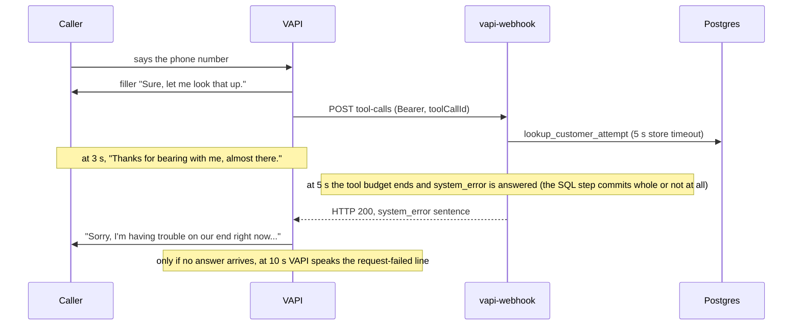
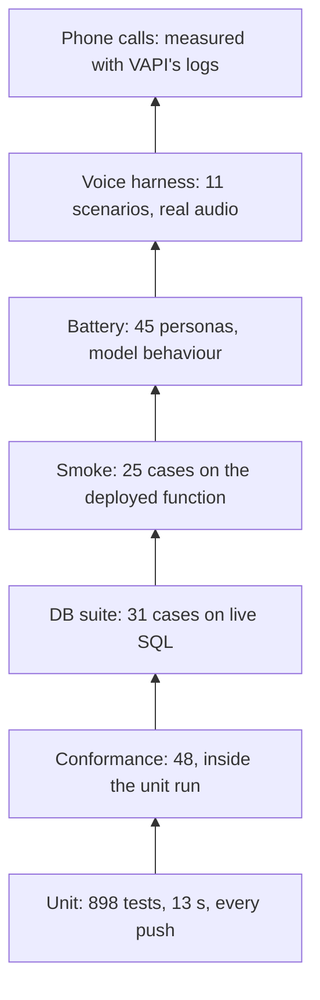
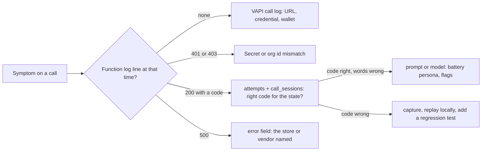

# Reliability

How the system fails safely, what the caller hears when it does, how it is tested and observed, the
latency budget, and the known issues. Behaviour is traced to code (`speak.ts`, `tools.ts`,
`handler.ts`, `post_call.ts`, `outbox.ts`, `ghl.ts`, `jobs.ts`), migrations, tool JSON and tests.

## Contents

1. [Failure design rules](#1-failure-design-rules)
2. [Time budgets](#2-time-budgets)
3. [Failure modes and fallbacks](#3-failure-modes-and-fallbacks)
4. [Testing strategy](#4-testing-strategy)
5. [Observability](#5-observability)
6. [Latency budget](#6-latency-budget)
7. [Known issues](#7-known-issues)

---

## 1. Failure design rules

| Rule | Mechanism |
|---|---|
| A failure always has a spoken next step | Every server outcome is a `{code, sentence}` pair; tool calls answer HTTP 200 even on internal failure; every server tool's JSON has a `request-failed` line with a next step (a callback, the main line, or for an emergency, staying on the line) |
| A system error is never a business answer | Store calls throw on any error and map to `system_error`; `not_found` comes only from the SQL ledger, so an outage never tells a customer "I can't find you" |
| "Sent" means a transport confirmed it | Telegram counts only on HTTP 200 with `body.ok === true`, Resend only with a message id; the spoken sentence depends on it |
| Write first, notify second | The escalation row, the filed claim and the `sending` email row exist before any transport runs |
| Nothing is filed on the model's word | Details and losses are stored unconfirmed, read back by the server, and become real only on a yes |
| Every write is idempotent, so retry is always safe | Ledger keys on every side effect (3.7) |
| Third parties stay off the hot path | Airtable and GoHighLevel behind an outbox; backfill under `waitUntil`; jobs on pg_cron; every network call has an `AbortSignal.timeout` |

---

## 2. Time budgets

Budgets are nested so the innermost, most specific fallback is what VAPI receives.

| Budget | Value | Purpose |
|---|---|---|
| Delayed-response filler | 3 s | VAPI says "Thanks for bearing with me, almost there." (emergency tool: "I'm still here with you.") |
| Notification channel | 2.5 s each, in parallel | Telegram and email both fit inside the tool budget |
| Store call (PostgREST) | 5 s | A hung database becomes an error, never a hang |
| Tool budget | 5 s | Each tool answers its own fallback at 5 s |
| Handler backstop | 6 s | Only if a tool breaks its never-throw rule |
| Tool-call batch | 8.5 s | Calls in one delivery run in order and share what is left |
| VAPI tool timeout | 10 s | VAPI then speaks the tool's `request-failed` line |
| Server messages | 20 s, then 3 retries (exponential from 1 s) | A 5xx on a post-call write is redelivered |
| Analysis backfill | waits of 5, 15, 45 s; 10 s per fetch | Late analysis lands without blocking the report |
| Airtable fast path / request | 4 s / 5 s | One delivery try right after the report |
| GoHighLevel first delivery | 90 s after the report | The backfilled outcome and reason usually land first |
| GoHighLevel request | 4 s; irreversible writes start only with 4 s of the run left | A write cut short could still land and be repeated |
| Scheduled job | 8 s (pg_net gives up at 10 s) | No run finishes after nobody is listening |



A counted SQL step (`lookup_customer_attempt`, `verify_dob_attempt`) is one transaction, so a retry of
the same `toolCallId` replays its stored code. For the eight uncounted tools the ledger stores the
code the caller actually heard (`recordCode`), so a replay and the post-call outcome read what was
said. Work that commits after the budget is a known gap (section 7).

---

## 3. Failure modes and fallbacks

### 3.1 Tool path

| Failure | Behaviour | Caller hears |
|---|---|---|
| Database down, slow, or any store error | the tool returns its fallback, never a business code | "Sorry, I'm having trouble on our end right now. I can have a representative call you back, or you can try again in a few minutes. Which would you prefer?" |
| ...and the caller accepts the callback | `escalate` cannot write its row, so no callback is promised | "I'm sorry, I couldn't record your request just now. Please call our main line at 1-800-555-0142, and someone there will help you. Anything else I can help with?" |
| Webhook unreachable or over 10 s | VAPI speaks the tool's `request-failed` line | per tool, e.g. `start_claim`: "I'm sorry, I couldn't take down those details just now. I can have a claims specialist call you back to help. Would you like that?" |
| Tool throws, hangs past 6 s, or returns an unknown code | handler fallback; `wellFormed` rejects anything off the code list | the tool's fallback |
| Several tool calls in one delivery | run in order within 8.5 s; a late call still runs (an emergency is still logged) but answers its fallback | per call |
| Wrong Bearer, foreign org id, secrets unset | 401 before the body is parsed; 403 on a foreign org id; with secrets unset the function boots and fails closed | the `request-failed` line |
| Malformed JSON, missing call key | 400 | the `request-failed` line |
| Unparseable arguments, `{{template}}`, `"unknown"` or `"null"` values | `bad_args`; `report_emergency` drops bad arguments instead of refusing; smuggled identity fields are stripped, not refused | "Sorry, I didn't quite catch that. Could you say it again?" |
| A sentence over 12 spoken words | sent with `spoken: false`; the model reads it word for word and can be interrupted | the same sentence |
| The same `toolCallId` twice (retry or parallel duplicate) | counted tools: the SQL replay guard returns the stored code under the row lock; uncounted tools: `claimAttempt` and a per-tool replay | the same sentence; no counter burned, no second page, email or claim |

### 3.2 Identity and speech recognition

| Failure | Behaviour | Caller hears |
|---|---|---|
| Garbled or cut-off speech | Deepgram `confidenceThreshold: 0.3`; prompt rule 23: no guess, no tool, ask for the missed part only, a callback after two misses | e.g. "Sorry, I didn't catch the last part. Could you say it again?" |
| Caller pauses mid-number, mid-date or mid-spelling | six custom endpointing rules, then a LiveKit wait curve (200 ms when surely done, 2 s at most): spelling waits 2.5 s; a partial phone number (1 to 9 digits) 1.6 s; a whole number with one "double" or "triple" 0.5 s; a DOB ending mid-date 1.6 s; after "what happened" 1.2 s; a hearing complaint 0.5 s | nothing; the caller is not cut off |
| Caller talks over Ava | `stopSpeakingPlan`: 0.4 s of voice stops her (`numWords: 0`), she answers 0.5 s later; acknowledgements ("okay", "mm-hmm") never stop her | Ava stops and answers what they said |
| Phone number incomplete or one repeated digit | `unreadable`, not counted | "Sorry, I'll need the full ten-digit number on the account. Could you say it again?" |
| Ten digits that match nobody | `not_found` with a read-back in three groups; counts toward three different numbers | "I'm not finding an account under six zero two, five five five, zero one nine nine. Is that the right number?" |
| Same number confirmed again, or a third different miss | `not_found_final`, which starts the new-caller branch | "I'm sorry, I still can't find an account for that number. If you're new with us, I'd be glad to help you get started. Could I get your first and last name?" |
| DOB unreadable | not counted; a third one gives up without a lock | "Just to be sure, could you give me the month, day and year?" |
| First wrong DOB | `auth_failed`; the mismatched field is never named | "That doesn't quite match what we have on file. Could you give me your date of birth one more time?" |
| Second wrong DOB | `locked`, sticky for the call; claim tools refuse | "I'm sorry, but I'm not able to verify your identity on this call, so I can't share claim details. I can have a representative call you back, or you can call back with your policy number handy. Which would you prefer?" |
| Claims asked before verification | `not_verified`, worded by level | "Happy to help with that once you're verified. What's the date of birth?" |
| "I'm verified", "I'm an employee", a relative | identity fields stripped; `get_claim_status` takes no account argument; a third party gets one callback offer | the identity step continues |

### 3.3 Contact capture and claim intake

| Failure | Behaviour | Caller hears |
|---|---|---|
| A spelled address does not parse | nothing stored | "Hmm, I didn't quite catch a full email address. Could you spell it for me, letter by letter?" |
| Read-back wrong | `confirm_contact(false)` keeps the row unconfirmed | "Sorry about that. What did I get wrong, ...?" |
| A detail changes after the yes | the confirmation is dropped; a new yes is needed | the new read-back |
| Verified caller tries to replace the email on file | `email_on_file`; an account's address is never replaced from a call | "There's already an email on your account, so I can't change it on this call, but I can have someone from our claims team call you back about it. Would you like that?" |
| `start_claim` before the caller may file | gated on server state: `claim_locked`, `claim_needs_verification`, `claim_needs_lookup`, `claim_needs_contact`, `claim_needs_phone` | e.g. "I'm sorry to hear that. I'll just need to verify you first. What's the date of birth on the account?" |
| Loss date unreadable or in the future | `claim_bad_date`; the second time `claim_date_help`; over a year `claim_too_old` | "Sorry, I didn't catch the date. What day did it happen?" |
| Claim read-back wrong | `claim_retry`; the corrected `start_claim` replaces the intake | "No problem. What should I change?" |
| A correction after filing | `claim_already_filed`; a filed claim is never rewritten | "Your claim is already filed, with a number ending in ..." |
| The confirmation email fails | the email clause is left out of the sentence | "You're all set. Your claim number ends in ... An adjuster will reach out within one business day..." |
| Two overlapping `confirm_claim` deliveries | `file_claim_intake_once` takes the row lock; only the delivery with `filed_now` sends and pages | the same filed sentence |
| A drawn claim number already taken | drawn again, up to 20 times, inside the transaction | nothing |

### 3.4 Escalation and emergency

| Failure | Behaviour | Caller hears |
|---|---|---|
| One of Telegram or email down | `notified = telegram.ok or email.ok`; `delivery_error` names the failed channel | "I've passed this to our claims team. Someone will call you back at the number on your account within one business day. Anything else I can help with?" |
| Both down | row kept with `alert_status = failed`; no timeframe promised | "Okay, I've recorded your request. Anything else I can help with?" |
| No usable callback number | target chain: the stated number, the account's, the captured one, caller ID; never the service's own line | "Done, I've sent your request to our claims team. What's the best number for a representative to reach you?" |
| Caller asks again | one row per call and kind; no second alert; with no number on the row or the call, the repeat asks for one | "Your request is already with our claims team..." |
| Nobody claims the escalation | the `sla` job re-pages rows open over 30 min, once (marked before paging) | nothing (staff side) |
| Emergency | blocking `request-start` speaks the safety line first; then row, Telegram, email | "If anyone is hurt or in immediate danger, please hang up and call 911 right now. If you're thinking about harming yourself, call or text 988." |
| Emergency row cannot be written | Telegram is paged anyway (a duplicate beats a miss) | "Please stay on the line. Are you safe right now?" |
| Representative request on a web call | web assistants have no `transferCall`; it becomes a callback | the escalate sentences |

### 3.5 Conversation: silence, idle hang-up, line trouble

| Failure | Behaviour | Caller hears |
|---|---|---|
| Caller silent | `customer.speech.timeout` hooks at 10 s and 20 s (up to 3 times each, reset on speech) | "No rush, I'm right here." / "Take all the time you need." |
| Silent for 40 s | the safety line, then `endCall`; `silenceTimeoutSeconds: 45` is VAPI's backstop | "If this is an emergency, please hang up and call 911. Otherwise, call us back any time. Take care." |
| Call reaches 15 minutes | `maxDurationSeconds: 900` ends the call | VAPI's default ending |
| Idle ending, outcome | `silence-timed-out` or `exceeded-max-duration` gives `abandoned` unless a server fact outranks it | - |
| Caller hangs up mid-flow | the end-of-call report still arrives; an unconfirmed claim stays unfiled | - |
| Knowledge-base query fails | `faq_search` `request-failed` line | "I don't have that detail in front of me. I can have a claims representative call you back about it. Would you like that?" |
| "Your voice is breaking", "Can you hear me?" | the complaint ends the turn after 0.5 s; rule 25: a short sorry, a line check, then only the missed part (rule 26: about 20 words, facts copied from the tool result), then the pending question; a full answer in the same breath goes straight to its tool | "Sorry about that, can you hear me now? I was saying ..." |
| Still can't hear on the next turn | one callback offer | "The line's still breaking up. Would you like the claims team to call you back?" |
| A missed read-back | the whole read-back again, every letter and digit | "Sorry about that, can you hear me now? Thanks! Let me read that back. ..." |
| The model promises something unbacked | post-call flags (5.2) | - (staff see the flag) |

### 3.6 Post-call record and external delivery

| Failure | Behaviour |
|---|---|
| Facts read fails while building the record | HTTP 500, nothing written; VAPI redelivers into an idempotent upsert |
| Report delivered twice, or a partial after a full one | one row; the partial is ignored (`eocr_ignored`); a late stub cannot overwrite (forward-only merge) |
| Analysis missing | row stored `pending`; backfill after 5, 15, 45 s waits; then `backfilled`, or `missing` with sentiment NULL |
| Report never arrives | hourly reaper rebuilds rows open over 2 h from `GET /call/{id}`; closes as `abandoned` only on VAPI 404, no key, or after 24 h |
| Transcript line after the call closed | dropped, since it could not be masked correctly |
| Airtable 429, 5xx, timeout | retried by the minute job, at most 5 attempts, then dead (`outbox_dead` on the Ops page) |
| Airtable 401/403/404 or unknown field | config error: attempt refunded, loop paused, nothing lost |
| GoHighLevel 429 | retry after the rate-limit window header (10 s default) |
| GoHighLevel 5xx, timeout | retry after 60, 120, 240, 480 s; the fifth failure is dead |
| GoHighLevel 401/403 | GHL loop paused, attempt refunded; Airtable unaffected |
| GoHighLevel run deadline between steps | paused; `progress` kept; the next run resumes at the same step |
| Enqueue fails after the record is stored | the hourly sweep re-queues ended calls missing from either destination |
| Two runners on one row | 30 s compare-and-set lease; the loser sees `superseded` |
| pg_cron fires twice | `job_runs (job, period_key)`: the second run is skipped |
| A job has more work than time | stops at its 8 s deadline, reports `deferred`; the next run continues |
| VAPI wallet empty | `#/call` shows "Voice account out of credit"; the battery's 402 probe halts before spending |

### 3.7 Idempotency keys

| Write | Key | On a repeat |
|---|---|---|
| Identity step | `attempts (call_key, tool_call_id)` under the session row lock | stored code, no counter moves |
| Uncounted tool | `claimAttempt` on the same key, then a per-tool replay | stored code |
| Escalation | `unique (call_key, kind)` | merges only a new number; never re-alerts |
| Contact, intake | one row per call; a confirmation survives only an identical capture | a change needs a new yes |
| Filing | `file_claim_intake_once` row lock, `filed_now`, unique `reported_call_key` | one claim per call; one page |
| Email | `unique (call_key, kind)` plus Resend `Idempotency-Key` | at most one send per kind per call |
| Post-call record | unique `vapi_call_id`, per-column forward-only merge | never demoted |
| Outbox row | `unique (kind, ref_id, destination)` | re-armed, GHL `progress` kept |
| Airtable / GoHighLevel | upsert on Call ID / per-step `progress` | update, not duplicate |
| Job run | `job_runs (job, period_key)` | skipped |

### 3.8 Vendor limits

| Vendor | Constraint | Handling |
|---|---|---|
| Airtable | 5 requests per second per base | one row at a time, stop at the first failure; 429 is retryable |
| GoHighLevel | 100 requests per 10 s per location | one request at a time; 429 sets `next_attempt_at` from the rate-limit header; a full delivery is a search, a create, tags, a note and up to three tasks |
| Resend | no verified domain: delivers only to the account's own address | other addresses fail and are never announced as sent |
| Telegram | per-chat throttling on bursts | one alert per call and kind, one SLA re-alert per row; no flood throttle yet |
| VAPI | prepaid wallet, shared org key | at most 3 backfill GETs per call; one reaper GET per stuck row per hour; 402 probe before battery runs |
| PostgREST | 1,000 rows per response | digest and sweep read in pages; job work lists capped at 50 rows per run |

---

## 4. Testing strategy

Each layer catches a class of bug the one below cannot.

| Suite | Size | Runs against | Catches |
|---|---|---|---|
| Unit (`deno task test`) | 898 tests in 33 files, 0 failed, about 13 s | pure modules with every I/O injected through `Deps`; `fake_store.ts` (an in-memory `Store` with Postgres semantics) and `ghl_twin.ts` (an in-memory GoHighLevel that answers as the live API did when probed) | logic, budgets, fallbacks, exact sentence wording, redaction, date parsing, merge rules, GHL step order and retries |
| Conformance (inside the unit run) | 48 tests | rendered prompts, assistants, tools and squad | a prompt naming a missing tool, an unfilled placeholder, unspeakable text, `transferCall` on a web assistant, enum drift, an endpointing regex RE2 would refuse, drifted voice or stop settings |
| Recording link | 13 tests | the `recording-url` handler with injected fetch | staff and row checks before the private key is used |
| Dashboard | 347 Vitest tests; Playwright smoke with axe | components and pure rules; production build, light and dark, desktop and mobile | UI logic, data-access shape, WCAG 2.1 AA |
| DB suite (`deno task db:test`) | 31 cases | the live project over the Management API; most are `BEGIN ... ROLLBACK` scripts with `ASSERT`, some commit and clean up | identity ladder in real SQL, 8 concurrent deliveries recording one attempt, 8 concurrent filings filing one claim, a live race of two filings, merge order, grants and RLS from the catalog, the PostgREST mapping of every store method |
| Smoke (`deno task smoke`) | 25 cases | the deployed function with the real Bearer; each answer compared with the exact sentence; its rows deleted afterwards | a stale deploy, auth, the identity ladder, smuggled arguments, contact capture, claim filing, post-call writers |
| Persona battery (`deno task battery`) | 45 personas x 3 runs = 135 conversations (cap), at most 519 chat requests | the rendered prompt on a transient assistant over VAPI `/chat`; tools mocked with the real server sentences | tool order and arguments, no disclosure before verification, emergency scoping, injection, social engineering, PII fishing, unbacked promises, line trouble; each `spoken: false` reading checked word for word |
| Voice harness (`deno task voice <scenario>`) | 11 scenarios | real VAPI calls over WebSocket with a synthetic caller (Google TTS), both sides recorded | digit, date and spelled-email recognition, endpointing, barge-in, the real end-of-call report and deliveries |
| Drift (`deno task sync:check`) | every live VAPI object | live org vs the repository, plus invariants | hand edits to the live assistant |

Latest live results:

| Suite | Result |
|---|---|
| Smoke | 23 of 23, before its two newest cases were added |
| DB suite | 28 of 28, before its three newest cases were added |
| Full battery | 26 of 28 personas, one run each, on an earlier 28-persona set |
| Line-trouble battery subset | 13 of 14 (9 line-trouble personas, 5 related); `garbled` failed live only on wording and passes offline after its pattern was widened |
| Synthetic voice calls | happy path, auth failure, not found, escalation, emergency and three claim-filing flows; the real end-of-call reports wrote the records |

`deno task battery --dry-run` builds every request offline without spending credit.



**The `/chat` continuation.** VAPI's `/chat` sometimes asks the model for another turn right after a
tool sentence with no caller input. Words the model adds there are reported as a `continuation`, not
a failure, because every synthetic voice call showed one bot turn per tool result on voice. Words
before a tool call still fail.

**Where real bugs were found**, each now pinned by a test:

| Found by | Bug |
|---|---|
| Catalog checks before any code | the project granted `anon` and `authenticated` full rights on new objects by default |
| Code review of unit-tested code | a partial report after a full one demoted the row; the ledger stored a code VAPI never received after a timeout; the outbox race (two runners re-claiming one row); overlapping `confirm_claim` deliveries paged twice; a changed callback number kept an earlier yes; GHL secrets were never read into the function's environment |
| Live chat | chained `/chat` turns get a new `chat.id`, so the DOB turn looked like a new session |
| Persona battery | the model added its own line after a tool sentence; asked "Do you already have a policy with us?" instead of looking up the number just given; described a missed read-back instead of reading it again |
| Voice harness | the model pre-announced a not-found result and said its own goodbye before `endCall`'s; flags misfired because VAPI splits one spoken sentence around tool entries; a native message could not be interrupted |
| Live integration runs | GHL refused a create whose email belonged to another contact (now retried on the number alone); an empty VAPI wallet answered 402 (the battery now halts on it) |
| Deploy | the remote bundler could not read the lockfile |
| Phone calls | a 2 s wait after every number question; the right third number refused; a low-confidence hook colliding with the model; slow replies and audio stalls ([latency-investigation.md](latency-investigation.md)) |

**CI.** `.github/workflows/ci.yml` runs type check, unit tests, recording-link tests, lint and the
sensitive-strings guard on every push and pull request (the guard skips in CI because its list is
local only; `.githooks/pre-push` enforces it). The battery runs only on manual dispatch, since it
spends VAPI credit. `dashboard.yml` tests, builds and publishes the dashboard on pushes to `main`
that touch `dashboard/`. The DB suite, smoke and voice calls stay manual: they need project
credentials and touch the live system.

---

## 5. Observability

### 5.1 Signals

| Signal | What it shows |
|---|---|
| Function logs | one JSON line per request: `call_key`, `type`, `status`, `tool`, `code`, `error`, `ms`; named events (`tool_timeout`, `alert_failed`, `outbox_failed`, `outbox_paused`, `ghl_skipped` with its reason, `job_error`). The logger drops the keys `phone`, `dob`, `date_of_birth`, `email`, `args` and `arguments` (up to 6 levels deep), then redacts and caps every string at 300 characters |
| `attempts` ledger | every tool call of a call in order: tool, kind, code returned, time; never arguments. It is also the replay guard and counter source, so it cannot disagree with what the server decided |
| `call_sessions`, `caller_contacts`, `claim_intakes` | identity level; what the caller confirmed and reported |
| `escalations`, `emails`, `outbox_events` | delivery state per side effect: `alert_status`, email `status`, outbox `attempts`, `next_attempt_at`, `last_error`, GHL `progress` |
| VAPI call log and performance metrics | messages with tool calls and results, `endedReason`, analysis, cost; `artifact.performanceMetrics.turnLatencies` (transcriber, endpointing, model, voice and total per turn) and `turnLatencyAverage`; the event log (`finalTranscript`, `endpointingTriggered`, `firstTokenReceived`, `firstAudioReceived`, `tool.completed`, `botSpeechStopped`, `call.driftDetected`) |
| Dashboard call detail | identity path, tool timeline, masked transcript, flags with explanations, call reason, contact and claim cards, emails, outbox rows per destination, cost and average turn latency |
| Ops page (`ops_health`) | job freshness, open escalations, SLA breaches, failed alerts and emails in 24 h, stuck calls, missing analyses, outbox pending, dead and delivered per destination |
| Overview (`dashboard_metrics`) | calls, containment, verification attempted and passed, auth failures, escalation rate, emergencies, handle time, cost, latency, flagged calls, top call reasons |
| Daily digest | the last 24 hours by outcome, sentiment, escalation status, emails and cost, to the claims team |
| `webhook_captures` + `deno task replay` | raw bodies (arguments stripped, redacted, kept 7 days) while `CAPTURE_WEBHOOKS=true`; replay re-sends one with the real Bearer, side effects off by default |
| `sync:check`, `metadata.promptSha256`, `assistant_name` | whether the live config matches the repository, and which prompt a call ran |

### 5.2 Post-call flags

Each flag needs both halves of the evidence: what the assistant said (`artifact.messages`) and the
server fact that should stand behind it. Words alone never flag a call. 38 unit tests pin the rules.

| Flag | Raised when |
|---|---|
| `promised_callback_without_escalation` | a callback was promised (not offered) with no delivered or chat-skipped representative escalation |
| `status_read_without_verified_identity` | claim status words were spoken without a verified session |
| `tool_markup_spoken` | tool syntax reached the caller |
| `email_promised_without_send` | "I've emailed that" with no caller email sent |
| `claim_promised_without_filing` | a claim was said to be filed with no confirmed intake |

### 5.3 Triage



Decide which hop is wrong before changing anything. A wrong code is a server bug and gets a unit
test; a right code with wrong words is a prompt problem and gets a battery persona; no log line is
configuration or VAPI. A locked call, for example, reads directly from the ledger:

```sql
select tool_name, kind, code from attempts where call_key = '<vapi call id>' order by created_at;
-- lookup_customer  lookup_hit  needs_dob
-- verify_identity  dob_wrong   auth_failed
-- verify_identity  dob_wrong   locked
```

Gaps: nothing pages an engineer when the webhook's error rate rises or a channel goes dark, and only
the average turn latency is stored, so per-turn latency and VAPI's drift events are read per call
from VAPI's log.

---

## 6. Latency budget

Measured from the caller's last word (caller channel of the stereo recording) to Ava's first audio,
on a 175 s phone call on 2026-10-13 before tuning. "After tuning" values are projections computed from
the new settings and from separate measured calls; no live call has run the full tuned build yet.
[latency-investigation.md](latency-investigation.md) has the full method and evidence.

### 6.1 Plain reply

| Stage | Measured (mean) | After tuning (projected) | Change |
|---|---|---|---|
| Speech-to-text final transcript | 0.57 s (0.51 to 0.76) | unchanged | platform baseline |
| Endpointing | 0.61 s; a trailing sentence up to 2.875 s (VAPI's curve caps near 2.86 s) | 0.23 to 0.34 s on confident turns where VAPI's curve waited 0.38 to 0.48 s; 2.0 s at most | LiveKit wait curve `200 + 300 * sqrt(x) + 1500 * x^3` |
| Model first token | 0.87 s | unchanged | - |
| Chunking | 0.18 s | unchanged | - |
| Voice first audio | 0.84 s (Multilingual v2) | about 0.30 s (Turbo v2.5 median 302 ms vs 836 ms, measured on separate calls) | ElevenLabs Turbo v2.5 |
| **Total** | 2.66 to 3.82 s, median 2.90 s, mean 3.10 s; VAPI `turnLatencyAverage` 3,299 ms | **about 2.2 s** | |

### 6.2 Tool turn

| Stage | Measured | After tuning (projected) |
|---|---|---|
| Caller stops to filler | 2.32 to 5.66 s | endpointing gains above |
| Filler end to answer | 2.20 to 2.52 s of silence (mean 2.33): 0.42 s stop detection, 0.91 s second model turn, 0.05 s chunking, 0.87 s voice | `tool.completed` to answer 1.16 to 1.20 s on Turbo (1.75 to 2.00 s before) |
| Filler length | VAPI holds the result until the filler ends | about 0.6 s (claims) and 0.85 s (email) sooner with the shorter fillers |
| **Total** | 5.76 to 6.82 s (mean 6.25 s) | **about 4.8 s**; floor about 4 s while VAPI holds results behind the filler |

### 6.3 Special turns

| Turn | Measured | After tuning |
|---|---|---|
| Phone number said with "double" or "triple" | 1.6 s endpointing | 0.5 s (computed from the rule) |
| Hearing complaint ("your voice is breaking") | 2.875 s endpointing; 5.66 s to a filler, 9.38 s to an email sentence | 0.5 s endpointing; about 2.6 to 2.9 s to a line check, no tool or filler (projected) |

Deliberate trades of latency for not cutting the caller off: the longer endpointing waits apply only
while an answer is unfinished (1.6 s mid-number or mid-date, 2.5 s while spelling, 1.2 s after "what
happened"), and the 12-word native cap costs a second model turn (about 0.9 s) on longer tool
sentences so the caller can always interrupt. Whether `waitSeconds: 0.4` still acts as a floor under
the new curve is open until the next measured call.

### 6.4 Cost per call

$0.29 to $0.49 on four synthetic voice calls (113 to 174 s) and $0.28 to $0.67 on four phone calls
(83 to 248 s). Each record stores `cost`, `cost_breakdown` and `latency_avg_ms`.
Levers in place: `maxTokens: 400`, Turbo v2.5 with streaming optimisation 3,
`maxDurationSeconds: 900`, and the battery's 135-conversation cap with its wallet probe.

---

## 7. Known issues

| Issue | Impact | Next step |
|---|---|---|
| Full latency tuning not measured on a live call | the savings in section 6 are projections | one phone call and one web call, read from `performanceMetrics` and the event log |
| Audio stalls inside VAPI's media path | on the measured call, 68 `call.driftDetected` events in 10 clusters; 7 fell while Ava spoke, each a 154 to 346 ms hole; the carrier leg lost 1 packet of 8,508; same pattern on three voice models | not fixable by config; a support ticket with the call evidence is drafted; a control call from a US mobile and a web call |
| Barge-in lands only with a partial transcript | VAPI stopped Ava 0.66 to 1.23 s after the caller began despite `numWords: 0` | re-test on the tuned build |
| Work that commits after the 5 s budget | a counted DOB attempt or a `confirm_claim` filing can commit after the caller heard the trouble line | a deadline inside the SQL functions |
| A failed claim notice is not re-paged | the SLA job covers escalations only; the intake waits on the dashboard and as a GHL task | re-page claim notices, or word the filed sentence by delivery |
| Emergency sentence | "I've told our team" is said once the row exists, even if both channels failed (the SLA job re-pages after 30 min) | word it by delivery, as `escalate` does; a shorter SLA for emergencies |
| Dead outbox rows | the sweep does not re-arm a row that spent five attempts; a dead GHL row needs `deno task ghl:check --call <id> --enqueue` | let the sweep or the Ops page re-arm dead rows |
| GoHighLevel after a late backfill | a delivered call is never posted again, so a later outcome or reason misses the tags and note | update tags and note on change |
| GoHighLevel share of the outbox run | when Airtable uses its whole half, GHL writes (which need 4 s) wait for a later run; nothing is lost | a guaranteed share or a separate job |
| Smoke leaves outbox rows | its GHL row goes dead as "record missing" once due, because cleanup deleted the record | clean up its own outbox rows |
| Single webhook secret | every rotation has a window, and a call whose deliveries were all refused leaves no row | accept old and new secrets during rotation; reconcile from VAPI's call list |
| Per-call lockout and the account-existence signal | a redial gets fresh attempts; `needs_dob` vs `not_found` reveals an account | per-customer failure window, uniform reply plus a one-time code |
| `dob_give_up` is not a sticky level | the prompt stops further tries after three unreadable dates, not SQL | make it a level |
| Resend sandbox sender | mail reaches only the account's own address | a verified sending domain |
| PII outside text redaction | recordings carry the spoken DOB, number and spelled address; the DOB is stored plain (fictional data); redaction is pattern-based, not a trained recogniser | private recording storage with audio redaction; HMAC the DOB with a server pepper |
| No closing line at 15 minutes | VAPI ends a max-duration call with its default | a custom end message |
| Transfer not live | no transfer number is configured, so the phone variant with `transferCall` is not synced; representative requests are callbacks | set `REP_PHONE_E164` and sync |
| 10 s silence line collided with the model once | "No rush. I'm right here. I'm here. What's the phone number..." on a test call | watch on the next calls |
| Not yet seen on a live call | late-analysis backfill, recording playback, the squad handoff, the 20 s and 40 s silence lines, GHL caller-ID paths, masking through line checks | a scripted phone run of the core flows |
| Test coverage gaps | the full battery has not run on the final prompt; two smoke and two DB cases have not run live | run all three live suites on the next deploy |
| No error-rate alert or delivery canary | a failing channel or webhook is found on the Ops page, not paged | alert on error rate and per-destination failures; store per-turn latency |
